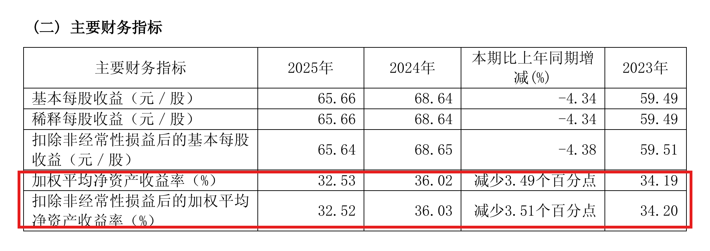
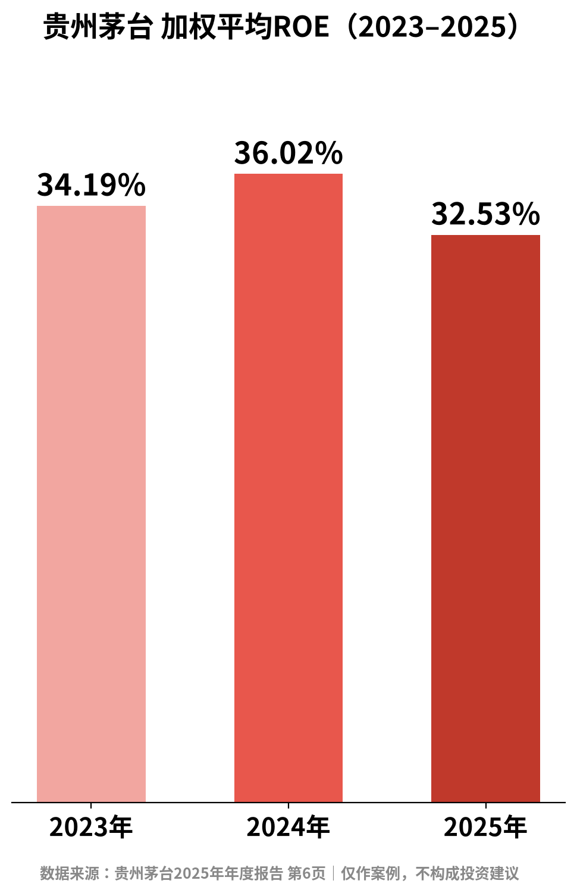

# ROE是什么？拿茅台年报教你看懂

| 项目 | 内容 |
|---|---|
| 作者 | Ari的财商笔记 |
| 首发日期 | 2026-10-30 17:40（北京时间） |
| 分类 | 价值投资 |
| 发布平台 | 小红书 · [雪球](https://xueqiu.com/9624362515/414840113) · 头条 |

> 仅为个人学习分享，不构成投资建议，投资有风险。文中举例数字如标注“假设”，均为演示用，不对应任何真实产品或个人。

## 正文

📌 本文拿贵州茅台做例子，只做案例，不是推荐。

总听人说“巴菲特很看重ROE”，那ROE到底是啥？去哪找？怎么看？今天拿一份真实年报，一次讲清楚👇

1️⃣ ROE是什么

ROE＝净资产收益率。说成大白话：股东投进公司的“本钱”（净资产）每100块，一年能赚回多少。

粗略公式：ROE ≈ 净利润 ÷ 净资产

年报里用的是「加权平均净资产收益率」，比直接拿年末数相除更准确。

2️⃣ 在年报哪里找？

不用翻完全本📖 直接找第二节「近三年主要会计数据和财务指标」这张表。

以《贵州茅台2025年年度报告》为例（PDF第6页），加权平均净资产收益率：

✅ 2023年：34.19%

✅ 2024年：36.02%

✅ 2025年：32.53%（比上年减少3.49个百分点）

3️⃣ 只看一个数不够，我会多看3件事

🔹 看趋势：一年高不算什么，连续几年稳不稳更重要。上面三年都在30%以上，但2025年比2024年回落了。原因要去年报「管理层讨论与分析」里找，别脑补。

🔹 看是不是靠借钱撑起来的：负债越高，同样的生意算出来的ROE也会越高。巴菲特在1979年致股东信里写过：“衡量管理层经营业绩的首要标准，是在不过度举债、不玩会计花招的前提下，让股东投入的资本赚到高回报，而不是每股收益年年增长。”（笔者译）

拿茅台2025年末的合并资产负债表算一下：总资产约3038.35亿元，负债合计约498.76亿元，资产负债率约16.4%（我自己用这两个数算的）。可以看出，它2025年的ROE主要不是靠高负债撑起来的。

🔹 跟同行比：不同行业ROE天生差很多，别跨行业硬比。

4️⃣ 新手容易踩的坑⚠️

❌ ROE高≠股价一定涨。ROE说的是公司赚钱的效率，跟你买的价格贵不贵是两回事。

❌ 一次性收益（比如卖资产）也能把某一年的ROE抬上去。可以对照同一张表里的「扣除非经常性损益后的加权平均净资产收益率」，茅台2025年这一项是32.52%，和32.53%几乎一样。

💭 我的感受：作为程序员，习惯先找数据源再下结论。自己翻一遍原版年报，找数只要几分钟，难的是弄懂数字背后的原因。

你看一家公司时，最先看哪个指标？评论区聊聊👇

仅为个人学习分享，不构成投资建议，投资有风险。

## 配图

## 数据来源 / 核实记录

### 来源
- 贵州茅台酒股份有限公司《2025年年度报告》，巨潮资讯，2026-04-17 披露：<https://static.cninfo.com.cn/finalpage/2026-04-17/1225114741.PDF>
  - 加权平均净资产收益率、扣非加权平均净资产收益率：第二节「七、近三年主要会计数据和财务指标」，PDF 第 6 页
  - 总资产、负债合计：财务报告「合并资产负债表」（2025 年 12 月 31 日），PDF 第 56–58 页
- Berkshire Hathaway 1979 年致股东信：<https://www.berkshirehathaway.com/letters/1979.html>
  - 原文："The primary test of managerial economic performance is the achievement of a high earnings rate on equity capital employed (without undue leverage, accounting gimmickry, etc.) and not the achievement of consistent gains in earnings per share."

备注：资产负债率约16.4%是用总资产和负债合计自己算的，不是年报直接给出的数；巴菲特那句为笔者自译。

---

*仅为个人学习分享，不构成投资建议，投资有风险。*
