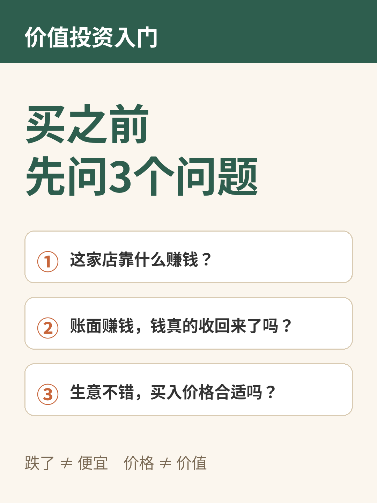
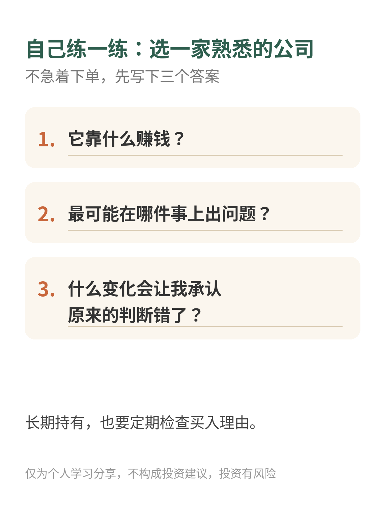

# 价值投资入门：买之前先问3个问题

| 项目 | 内容 |
|---|---|
| 作者 | Ari的财商笔记 |
| 首发日期 | 2026-10-30 22:11（北京时间） |
| 分类 | 价值投资 |
| 发布平台 | 小红书 · [雪球](https://xueqiu.com/9624362515/414840454) |

> 仅为个人学习分享，不构成投资建议，投资有风险。文中举例数字如标注“假设”，均为演示用，不对应任何真实产品或个人。

## 正文

看到一只股票跌了很多，你的第一反应是什么？

“便宜了，机会来了？”

先别急。10元跌到5元，只能说明价格降了，不能证明它值得买。

理解价值投资，可以先从一家楼下的小店开始👇

假设有人想把一家咖啡店的一部分股权卖给你，你大概不会只看它昨天的报价，而会先问：

① 这家店靠什么赚钱？☕

顾客为什么来？是位置方便、产品好，还是一直靠打折？如果隔壁开了新店，老顾客还会留下吗？

看一家上市公司，也可以先试着用自己的话讲清楚：它卖什么、谁付钱、顾客为什么选它。

如果买入理由只剩“大家都说好”，就还需要继续了解。

② 账面赚钱，钱真的收回来了吗？💰

一家店说今年赚了不少，但客户欠款一直没收回，租金、工资和贷款却得照付，日子未必轻松。

看企业时，利润之外，还要结合现金流、负债和后续投入一起判断。单独一个漂亮数字，讲不完一家公司的故事。

③ 生意不错，买入价格合适吗？🏷️

再喜欢的店，也得算算买入成本。

假设一家小店每年可分给股东的现金稳定为10万元：花100万元买下，和花200万元买下，对应的现金回报水平不同。

这只是帮助理解价格的假设，现实中收入会变化，设备要更新，生意也可能变差，不能据此套出股票的“合理价”。

所谓安全边际，就是承认自己可能判断错，给估值和未来的不确定性留些余地。它也不能保证不亏钱。

🌱 普通人怎么开始练习？

先选一家熟悉的公司，不急着下单，写下三个答案：

它靠什么赚钱？

最可能在哪件事上出问题？

什么变化会让我承认原来的判断错了？

再回头看：自己是在理解一门生意，还是只期待有人出更高的价格？

最后，长期持有也需要定期检查买入理由。时间不会自动修复一家持续恶化的公司。

先考虑资金什么时候要用、能承受多大损失，再考虑投资。分散投资有助于管理风险，但不保证盈利。

💬 如果让你研究一家熟悉的公司，你会从哪一家开始？

仅为个人学习分享，不构成投资建议，投资有风险。

## 配图

## 数据来源 / 核实记录

### 来源

本文讲的是投资思路，不引用外部统计数据或公司财务数据。文中咖啡店、10元跌到5元、每年10万元现金、100万元/200万元买入等数字均为**假设**，只用来帮助理解，不对应任何真实公司或股票。

---

*仅为个人学习分享，不构成投资建议，投资有风险。*
