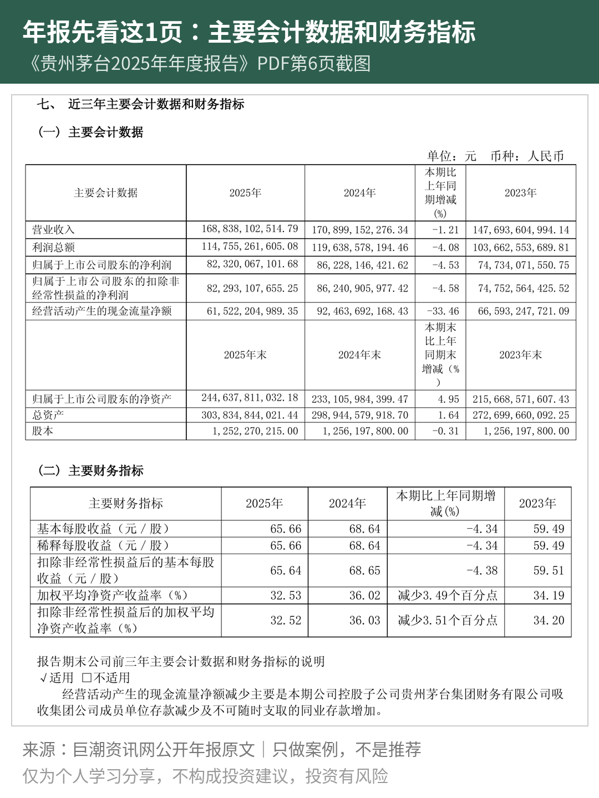
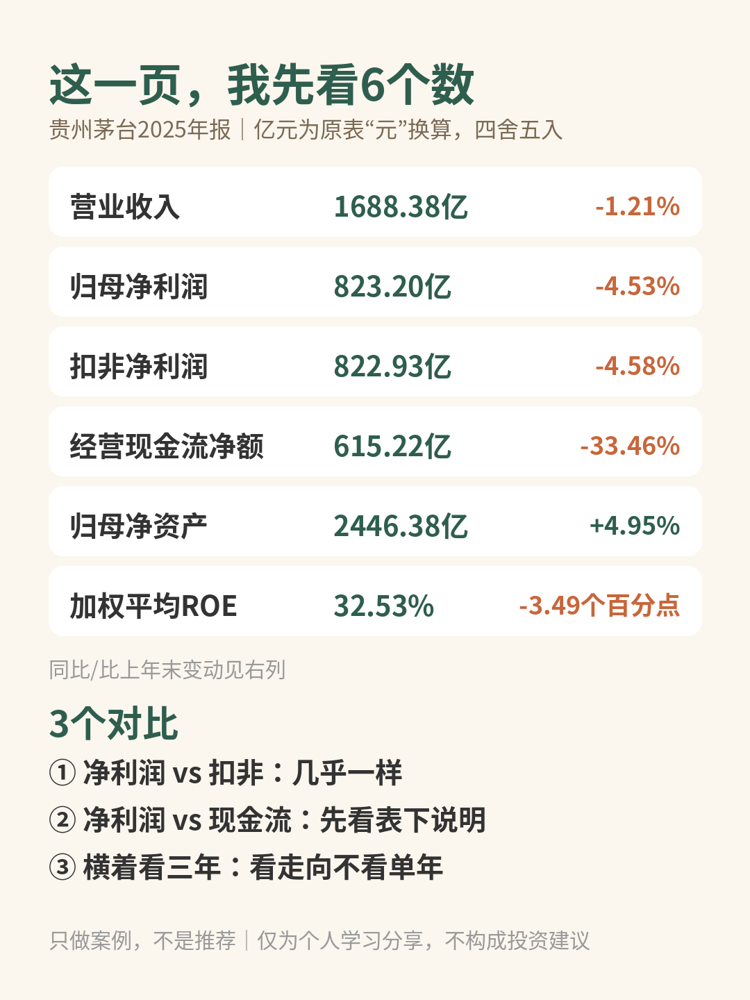

# 年报143页，新手先看这1页

| 项目 | 内容 |
|---|---|
| 作者 | Ari的财商笔记 |
| 首发日期 | 2026-10-31 20:01（北京时间） |
| 分类 | 价值投资 |
| 话题 | #价值投资 #年报 #财报分析 #读财报 #投资入门 #贵州茅台 |
| 发布平台 | 小红书 · [雪球](https://xueqiu.com/9624362515/414940011) |

> 仅为个人学习分享，不构成投资建议，投资有风险。文中举例数字如标注“假设”，均为演示用，不对应任何真实产品或个人。

## 正文

📌 本文拿贵州茅台做例子，只做案例，不是推荐。

第一次打开年报PDF，143页😵 从哪看起？

我的办法：先翻到「近三年主要会计数据和财务指标」这张表。以《贵州茅台2025年年度报告》为例，就在PDF第6页（图1）👇

1️⃣ 这页有什么

三年数据并排，还直接给了同比增减。我挑6个（原表单位是元，亿元是我换算的，四舍五入）：

🔹 营业收入：1688.38亿，同比-1.21%（卖了多少货）

🔹 归母净利润：823.20亿，同比-4.53%（属于股东的利润）

🔹 扣非净利润：822.93亿，同比-4.58%（去掉一次性损益后的利润）

🔹 经营活动现金流量净额：615.22亿，同比-33.46%（经营实际流入的现金）

🔹 归母净资产：2446.38亿，比上年末+4.95%（股东的“本钱”）

🔹 加权平均ROE：32.53%，比上年减少3.49个百分点（上一篇专门讲过）

2️⃣ 我会做的3个对比

① 净利润 vs 扣非：823.20亿和822.93亿几乎一样，说明非经常性损益很小，利润基本来自日常经营。

② 净利润 vs 现金流：现金流615.22亿，比净利润少，同比还降了33.46%。先别慌，表格下面就有说明：主要是控股子公司贵州茅台集团财务有限公司吸收集团公司成员单位存款减少，以及不可随时支取的同业存款增加。

👉 数字异常时，先找年报自己的解释。

③ 横着看三年：同一行看2023→2025的走向，比只看一年靠谱。

3️⃣ 新手容易踩的坑⚠️

❌ 只看营收、利润涨没涨，不看现金流

❌ 看到同比下降就下结论，不看原因说明

❌ 这一页只是“体检摘要”，细节还要去看财务报表和管理层讨论与分析

💭 我的感受：读代码我习惯先看README再钻细节，读年报也一样。这一页就像年报的README，几分钟能知道大概状况，再决定往哪里深挖。

你第一次读年报卡在哪？评论区聊聊👇

仅为个人学习分享，不构成投资建议，投资有风险。

## 配图

## 数据来源 / 核实记录

### 来源（从年报PDF第6页提取原表数字逐个核对）

全部来自《贵州茅台酒股份有限公司2025年年度报告》https://static.cninfo.com.cn/finalpage/2026-04-17/1225114741.PDF ，PDF第6页「七、近三年主要会计数据和财务指标」。

| 正文数字 | 原表数字（元/%） |
|---|---|
| 总页数143页 | 页脚“6 / 143” |
| 营业收入1688.38亿，同比-1.21% | 168,838,102,514.79；-1.21 |
| 归母净利润823.20亿，同比-4.53% | 82,320,067,101.68；-4.53 |
| 扣非净利润822.93亿，同比-4.58% | 82,293,107,655.25；-4.58 |
| 经营活动现金流量净额615.22亿，同比-33.46% | 61,522,204,989.35；-33.46（2024年 92,463,692,168.43） |
| 归母净资产2446.38亿，比上年末+4.95% | 244,637,811,032.18；4.95 |
| 加权平均ROE 32.53%，减少3.49个百分点 | 32.53；减少3.49个百分点 |
| 现金流减少原因 | 表下说明原文：“经营活动产生的现金流量净额减少主要是本期公司控股子公司贵州茅台集团财务有限公司吸收集团公司成员单位存款减少及不可随时支取的同业存款增加。” |

亿元换算＝原数÷1亿，四舍五入到两位小数，自己算的。

---

*仅为个人学习分享，不构成投资建议，投资有风险。*
