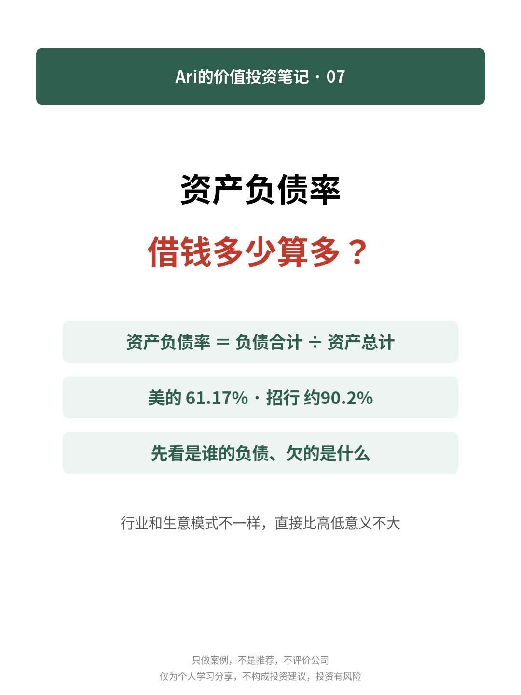
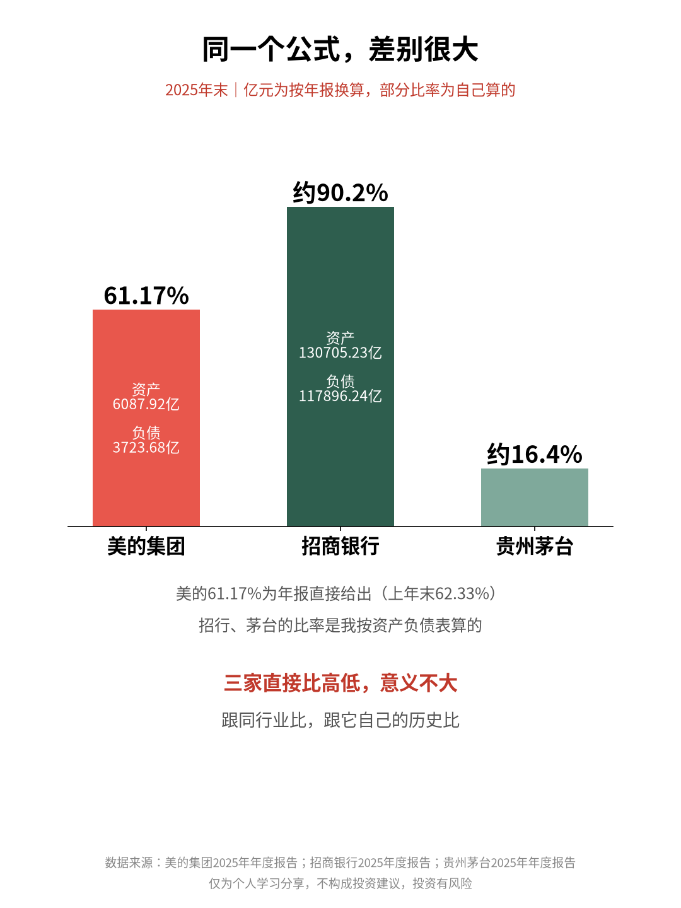
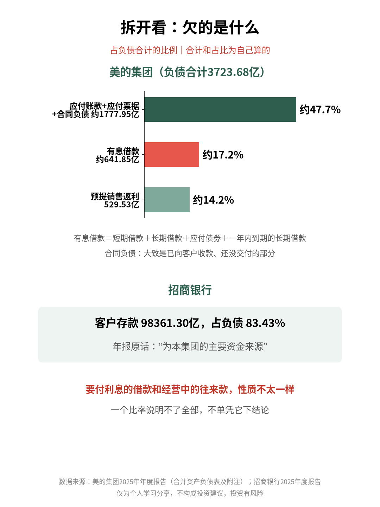

# 资产负债率：借钱多少算多？

| 项目 | 内容 |
|---|---|
| 作者 | Ari的财商笔记 |
| 首发日期 | 2026-11-01 09:13（北京时间） |
| 分类 | 价值投资 |
| 话题 | #价值投资 #资产负债率 #财报分析 #读财报 #投资入门 #资产负债表 |
| 发布平台 | 小红书 · [雪球](https://xueqiu.com/9624362515/414939886) · [知乎](https://zhuanlan.zhihu.com/p/2100157561664173864) · 头条 |

> 仅为个人学习分享，不构成投资建议，投资有风险。文中举例数字如标注“假设”，均为演示用，不对应任何真实产品或个人。

## 正文

📌 本文拿美的集团、招商银行2025年年报做例子，只做案例，不是推荐，也不评价这两家公司。

“负债率60%是不是太高了？”我以前也会直接拿这个数比。翻了几份年报才发现，得先看是谁的负债、欠的是什么👇

1️⃣ 怎么算

资产负债率＝负债合计÷资产总计

意思是：公司每100元资产里，大约有多少是别人的钱。

2️⃣ 同一个公式，差别很大（亿元为我换算）

🔹 美的集团：2025年末资产6087.92亿、负债3723.68亿，资产负债率61.17%（年报直接给出，我用资产负债表复算一致）

🔹 招商银行：资产130705.23亿、负债117896.24亿，我算出来约90.2%

🔹 之前算过的茅台：约16.4%

行业和生意模式不一样，三家直接比高低，意义不大。

3️⃣ 拆开看欠的是什么

美的的负债里：

🔹 应付账款1036.80亿、应付票据271.22亿、合同负债469.93亿，合计约1777.95亿，占负债约47.7%。主要是和供应商、客户之间的往来款，合同负债大致是已向客户收款、还没交付的部分

🔹 预提销售返利529.53亿，约占14.2%

🔹 短期借款、长期借款、应付债券、一年内到期的长期借款，合计约641.85亿，约占17.2%

同样叫负债，要付利息的借款和经营中的往来款，性质不太一样。

招商银行的负债里，客户存款98361.30亿，占83.43%。年报原话是“为本集团的主要资金来源”。负债率高和银行的生意模式有关，一般还要结合资本充足率这类监管指标看。

4️⃣ 我会怎么看

✅ 跟同行业比，跟它自己的历史比（美的上年末是62.33%）

✅ 拆开负债结构，看有息负债占多少

✅ 对照货币资金和经营现金流，看还钱的底气

✅ 一个比率说明不了全部，不单凭它下结论

💭 我的感受：这有点像看服务器内存占用，同样80%，是缓存占着还是内存泄漏，是两回事，得点进去看占的是什么。

你看财报时会拆负债结构吗？评论区聊聊👇

仅为个人学习分享，不构成投资建议，投资有风险。

## 配图

## 数据来源 / 核实记录

### 核实记录（2026-10-31 从巨潮资讯下载年报PDF提取原文，Python 复算）

来源：
- A《美的集团股份有限公司2025年年度报告》（000333，2026-03-31披露，276页）https://static.cninfo.com.cn/finalpage/2026-03-31/1225065145.PDF 。资产负债表金额单位：人民币千元。
- B《招商银行股份有限公司2025年度报告（A股）》（600036，2026-03-28披露，350页）https://static.cninfo.com.cn/finalpage/2026-03-28/1225047590.PDF 。单位：人民币百万元。
- 页码均为 PDF 页序（印刷页码=PDF页−1）。

| # | 正文事实 | 来源/页码 | 原文摘录 |
|---|---|---|---|
| 1 | 美的资产总计6087.92亿、负债合计3723.68亿 | A 第132–133页 合并资产负债表 | “资产总计 608,791,766”“负债合计 372,367,543”（千元） |
| 2 | 资产负债率61.17%，上年末62.33%（年报直接给出） | A 第124页；第269页“资本管理” | “资产负债率 61.17% 62.33% -1.16%”；“利用资产负债率(以总负债除以总资产)监控资本结构” |
| 3 | 复算一致 | 自己算 | 372,367,543÷608,791,766=61.17%；2024：376,684,462÷604,351,853=62.33% |
| 4 | 应付账款1036.80亿、应付票据271.22亿、合同负债469.93亿，合计1777.95亿，占负债47.7% | A 第133页 | “应付票据 27,121,881”“应付账款 103,680,491”“合同负债 46,993,060”；合计及占比自己算（177,795,432÷372,367,543=47.746%，四舍五入写“约47.7%”） |
| 5 | 合同负债含义 | A 第169页 收入政策 | “本集团已收或应收客户对价而应向客户转让产品的义务列示为合同负债。”（正文写“大致是已向客户收款、还没交付的部分”） |
| 6 | 预提销售返利529.53亿，约14.2% | A 第214页 附注四(36)其他流动负债 | “预提销售返利 52,952,866” |
| 7 | 短期借款+长期借款+应付债券+一年内到期的长期借款≈641.85亿，约17.2% | A 第133页、第214页附注四(35) | “短期借款 43,904,550”“长期借款 12,658,843”“应付债券 3,194,774”“一年内到期的长期借款 4,426,471”；合计自己算 |
| 8 | 招行资产130705.23亿、负债117896.24亿 | B 第26、30页；第127页合并资产负债表 | “本集团资产总额130,705.23亿元”“负债总额117,896.24亿元”；“资产合计 13,070,523”“负债合计 11,789,624”（百万元） |
| 9 | 招行资产负债率约90.2% | 自己算 | 11,789,624÷13,070,523=90.20%（年报未直接给出该比率） |
| 10 | 客户存款98361.30亿，占83.43%，“为本集团的主要资金来源” | B 第30页 3.3.2负债 | “本集团客户存款总额98,361.30亿元……占本集团负债总额的83.43%，为本集团的主要资金来源。” |
| 11 | 茅台约16.4% | 茅台2025年报（见《ROE是什么？拿茅台年报教你看懂》） https://static.cninfo.com.cn/finalpage/2026-04-17/1225114741.PDF 总资产3038.35亿、负债合计498.76亿 | 498.76÷3038.35=16.42% |
| 12 | “一般还要结合资本充足率这类监管指标看” | B 第16页列示“资本充足率指标(%)（高级法）”：核心一级资本充足率14.16% | 正文未写具体数，只作一般性提示 |

备注：
- 招行合并资产负债表里“客户存款”为9,924,558百万元（含应计利息），正文用的是管理层讨论口径98,361.30亿元及其83.43%占比，二者口径不同，正文已只用后者。
- 美的“其他流动负债”中“其他”395.85亿元未展开，正文未提。

---

*仅为个人学习分享，不构成投资建议，投资有风险。*
