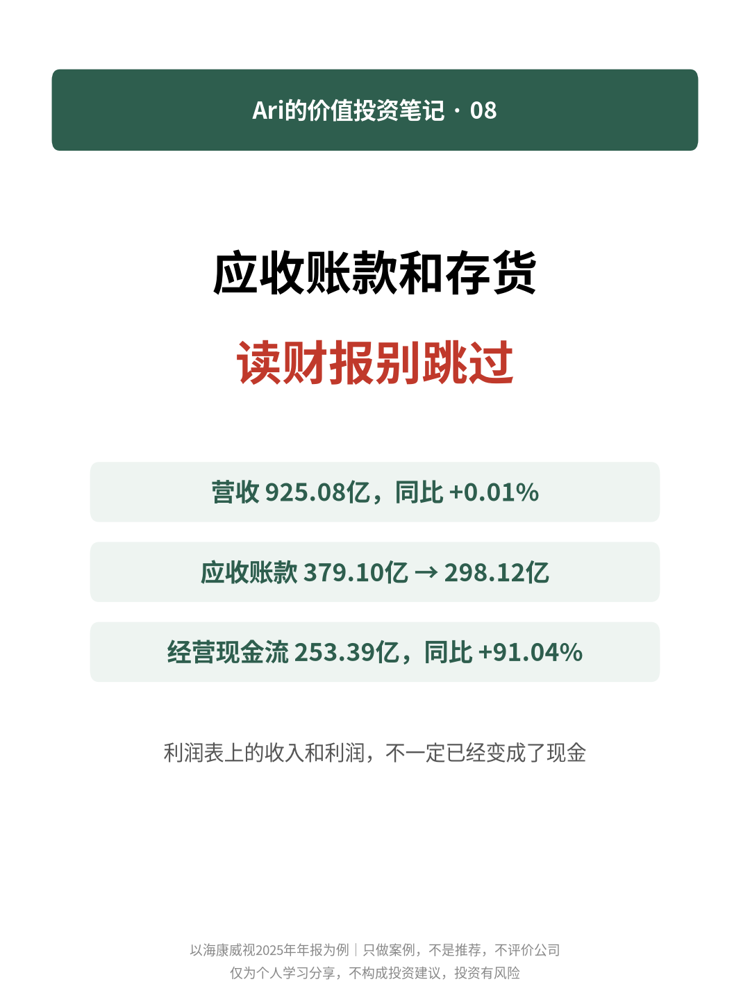
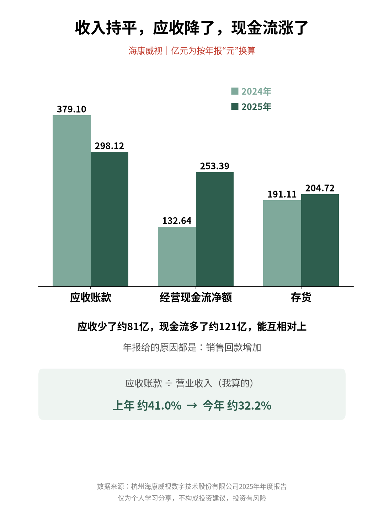
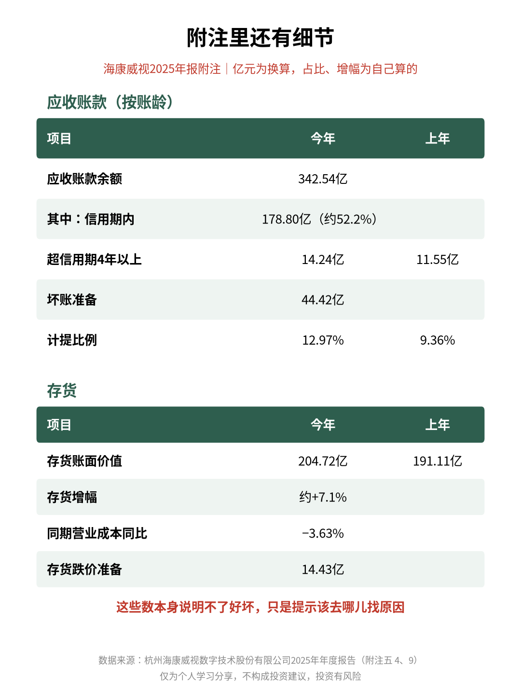

# 应收账款和存货，读财报别跳过

| 项目 | 内容 |
|---|---|
| 作者 | Ari的财商笔记 |
| 首发日期 | 2026-11-03（北京时间） |
| 分类 | 价值投资 |
| 话题 | #价值投资 #应收账款 #存货 #财报分析 #读财报 #投资入门 |
| 发布平台 | 小红书 · [雪球](https://xueqiu.com/9624362515/415188921) · [知乎](https://zhuanlan.zhihu.com/p/2100878691039556713) |

> 仅为个人学习分享，不构成投资建议，投资有风险。文中举例数字如标注“假设”，均为演示用，不对应任何真实产品或个人。

## 正文

📌 本文拿海康威视2025年年报做例子，只做案例，不是推荐，也不评价这家公司。

利润表上的收入和利润，不一定已经变成了现金。中间常见的两站：应收账款和存货👇

1️⃣ 两个科目是什么

🔹 应收账款：货卖出去了，钱还没收回来

🔹 存货：原材料、在产品、产成品，钱花出去了，东西还没卖掉

所以光看利润不够，还要看这两个数跟收入、成本是不是同步变化。

2️⃣ 一个真实例子（亿元为我换算）

《杭州海康威视数字技术股份有限公司2025年年度报告》：

🔹 营业收入925.08亿，同比+0.01%

🔹 应收账款从379.10亿降到298.12亿，年报给的原因是“销售回款增加”

🔹 经营现金流净额253.39亿，同比+91.04%，年报也说主要是销售回款增加

收入基本持平，应收少了约81亿，现金流多了约121亿，这几个数能互相对上。

我算了下应收账款占营收的比例：上年约41.0%，今年约32.2%。

3️⃣ 附注里还有细节

应收账款按账龄披露：余额342.54亿，信用期内约178.80亿，占约52.2%；超信用期4年以上14.24亿，上年是11.55亿。坏账准备44.42亿，计提比例从9.36%升到12.97%。

存货：账面价值从191.11亿到204.72亿，增加约7.1%；同期营业成本减少3.63%。存货跌价准备14.43亿。

这些数本身说明不了好坏，只是提示我该去哪儿找原因。

4️⃣ 我会怎么看

✅ 应收、存货的增速，跟收入、成本的增速对比着看

✅ 去附注看账龄和跌价准备，别只盯总数

✅ 对照经营现金流，看利润有多少真收成了现金

✅ 不同行业收款周期差别大，最好跟同行、跟自己的历史比

💭 我的感受：这像开小店，账本上记着卖了多少，可钱有没有进口袋、货是不是还堆在仓库，得另外去看。

你看财报时，会翻应收账款的账龄表吗？评论区聊聊👇

仅为个人学习分享，不构成投资建议，投资有风险。

## 配图

## 数据来源 / 核实记录

### 核实记录从巨潮资讯下载年报PDF，pdftotext 提取，Python 复算

来源：《杭州海康威视数字技术股份有限公司2025年年度报告》（002415，2026-04-18披露，263页）https://static.cninfo.com.cn/finalpage/2026-04-18/1225123062.PDF 。单位：人民币元。页码为 PDF 页序（印刷页码=PDF页−1）。

| # | 正文事实 | 页码 | 原文摘录 |
|---|---|---|---|
| 1 | 营业收入925.08亿，同比+0.01% | 第9页 主要会计数据 | “营业收入（元） 92,507,796,069.94 92,495,525,118.30 0.01%” |
| 2 | 应收账款379.10亿→298.12亿，原因“销售回款增加” | 第94页 资产构成重大变动；第147页合并资产负债表 | “应收账款 29,812,378,945.77 21.60% 37,910,128,735.42 28.72% -7.12% 销售回款增加” |
| 3 | 经营现金流净额253.39亿，同比+91.04%，主要因销售回款增加 | 第9页；第93页 | “经营活动产生的现金流量净额（元） 25,339,411,083.10 13,264,092,022.73 91.04%”；“经营活动产生的现金流量净额变动的主要原因是本年销售回款增加” |
| 4 | 应收少约81亿、现金流多约121亿 | 自己算 | 379.10−298.12=80.98；253.39−132.64=120.75 |
| 5 | 应收账款/营收：41.0%→32.2% | 自己算 | 37,910,128,735.42÷92,495,525,118.30=40.99%；29,812,378,945.77÷92,507,796,069.94=32.23% |
| 6 | 应收余额342.54亿；信用期内178.80亿（52.2%）；超信用期4年以上14.24亿（上年11.55亿）；坏账准备44.42亿 | 第197页 附注(五)4(1) | “信用期内 17,879,899,419.40 21,885,251,680.47”“超信用期 4 年以上 1,424,040,952.65 1,155,004,826.72”“合计 34,253,908,363.72”“减：坏账准备 4,441,529,417.95” |
| 7 | 计提比例9.36%→12.97% | 第197页 附注(五)4(2) | 年末“12.97”，年初“9.36”（自己复算一致） |
| 8 | 存货191.11亿→204.72亿，+7.1%；存货跌价准备14.43亿 | 第203页 附注(五)9；第147页 | “合计 21,915,263,033.46 1,443,069,174.66 20,472,193,858.80 … 19,110,711,958.11”；增幅自己算7.12% |
| 9 | 营业成本同比−3.63% | 第151页 合并利润表；第90页 | “营业成本 50,067,436,550.36 51,953,857,912.21”；第90页“-3.63%” |

备注：
- 年报第94页对存货变动的说明是“无重大变动”，正文未写原因，只提示“去哪儿找原因”。
- 应收账款账面价值减少80.98亿，其中坏账准备增加5.28亿，余额减少75.70亿（自己算），正文用账面价值口径，与年报第94页一致。
- 另算了应收周转天数约133.6天、存货周转天数约144.3天（平均账面价值口径），因口径需要解释，正文未使用。

---

*仅为个人学习分享，不构成投资建议，投资有风险。*
