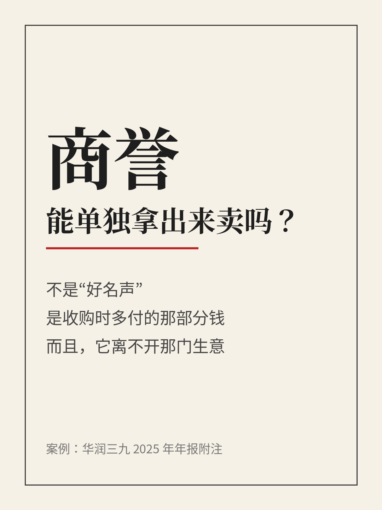
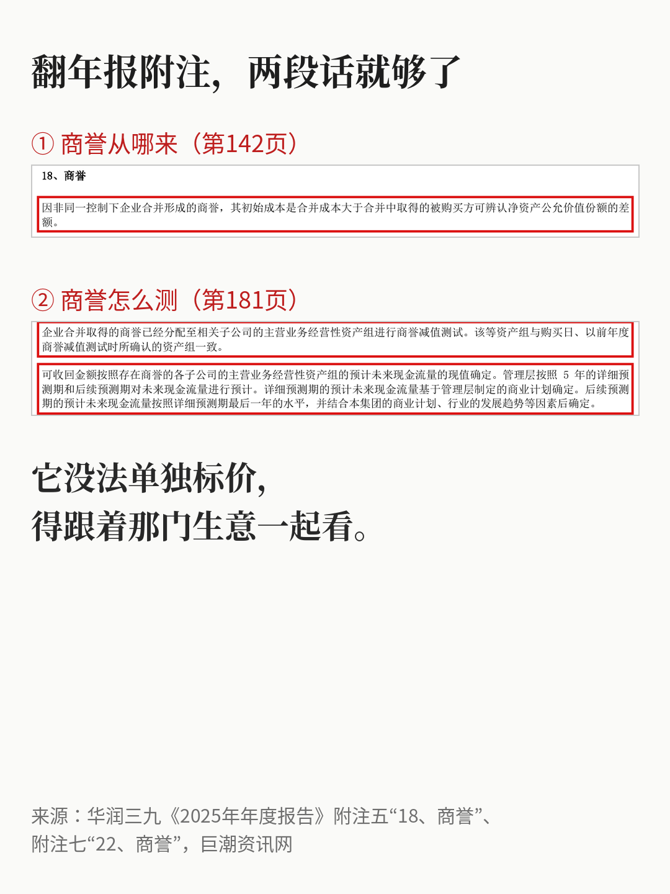

# 商誉这个东西，能单独拿出来卖吗？

| 项目 | 内容 |
|---|---|
| 作者 | Ari的财商笔记 |
| 首发日期 | 2026-11-09 12:48（北京时间） |
| 分类 | 价值投资 |
| 发布平台 | 小红书 |

> 仅为个人学习分享，不构成投资建议，投资有风险。文中举例数字如标注“假设”，均为演示用，不对应任何真实产品或个人。

## 正文

第一次在资产负债表上看到“商誉”两个字，我下意识以为是公司的好名声、品牌口碑之类的。后来翻了几份年报的附注才发现，想偏了。

这次拿华润三九2025年年报来对照着看（只当案例，不是推荐）。年报附注里写得很直白：非同一控制下企业合并形成的商誉，初始成本是合并成本大于取得的被购买方可辨认净资产公允价值份额的差额。

说人话，它就是“收购时多付的那部分钱”。

举个纯假设的例子：甲公司花100万买下乙公司全部股权，乙公司的资产负债一项项按公允价值认完，可辨认净资产是80万。那100减80，多出来的20万就记成商誉。它记录的是这笔交易的差价，不等于“乙公司口碑值20万”。

那这20万能不能单独拿去卖？我想了一下，基本不能。

设备能卖，存货能卖，专利这类能单独辨认的东西，收购时本来就要单独认出来。剩下说不清、拆不开的部分，才叫商誉。买方愿意多付，往往是看好团队、渠道、整合之后的协同。但看好归看好，后来能不能兑现，得靠经营说话。

华润三九的做法也印证了这一点：商誉被分配到相关子公司的主营业务经营性资产组里做减值测试，用这些资产组预计未来现金流量的现值来确定可收回金额。也就是说，商誉没法单独估值，得跟着那门生意一起看。

所以现在我再看到一家公司商誉比较大，会多问几句：

它是哪次收购留下的？

被放在哪块业务里测试？

测试时对收入增长、毛利率、折现率做了什么假设，依据是什么？

商誉大，不说明收购就成功了；有减值的可能，也不能没核对就说公司出了问题。把当初为什么买、买完之后经营得怎么样放在一起看，大概才更接近真实情况。

你看财报时碰到商誉，一般先看哪一块？

资料来源：华润三九《2025年年度报告》附注五“18、商誉”“20”、附注七“22、商誉”（巨潮资讯网）。例子中100万、80万、20万均为假设。

仅为个人学习分享，不构成投资建议，投资有风险。

## 配图

## 数据来源 / 核实记录

# 核实记录（2026-11-09 12:4x）
- 华润三九《2025年年度报告》 巨潮 https://static.cninfo.com.cn/finalpage/2026-03-21/1225023101.PDF
  - 第142页 附注五「18、商誉」：非同一控制下企业合并形成的商誉初始成本=合并成本大于被购买方可辨认净资产公允价值份额的差额 ✔
  - 第143页 附注五「20」：依据资产组受益于协同效应情况分摊商誉、以预计未来现金流量现值等确定可收回金额 ✔
  - 第181页 附注七「22、商誉」：分配至相关子公司主营业务经营性资产组做减值测试；可收回金额按预计未来现金流量现值确定；关键假设含收入增长率、预算毛利率、折现率 ✔
- 100/80/20 万为假设，文中已标注。

---

*仅为个人学习分享，不构成投资建议，投资有风险。*
