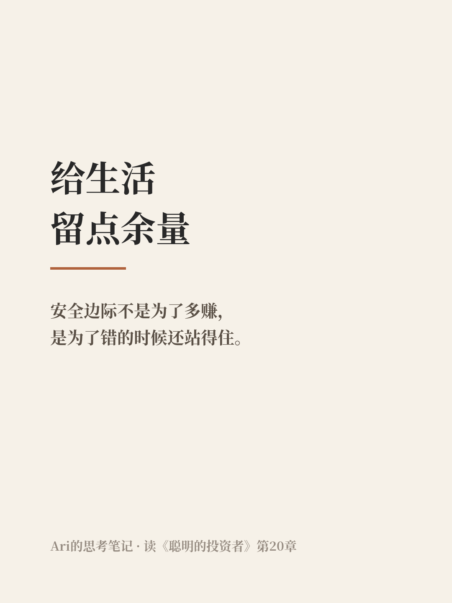

# 给生活留点余量，和买股票留安全边际是一回事

| 项目 | 内容 |
|---|---|
| 作者 | Ari的财商笔记 |
| 首发日期 | 2026-11-05 09:52（北京时间） |
| 分类 | 思考 |
| 发布平台 | [雪球](https://xueqiu.com/9624362515/415601933) · [头条](https://www.toutiao.com/article/7705410593180451366/) |

> 仅为个人学习分享，不构成投资建议，投资有风险。文中举例数字如标注“假设”，均为演示用，不对应任何真实产品或个人。

## 正文

格雷厄姆在《聪明的投资者》最后一章里说，如果要把稳健投资的秘诀浓缩成三个词，他会选「安全边际」（MARGIN OF SAFETY）。

以前我对这个词的理解，就是买得便宜一点。估出来一家公司值100，花70买，中间那30就是缓冲。后来重读这一章，注意到他说这段余量是用来吸收算错和运气不好带来的影响的。

这句话让我停了一下。它默认的前提是：你一定会算错，运气也不会一直好。安全边际不是为了多赚，是为了错的时候还站得住。

想到这儿，我发现自己生活里不少慌乱，其实都是没留余量造成的。

赶高铁卡着点出门，路上堵一下就满头大汗。月底工资刚好花完，冰箱一坏就得刷信用卡。日程排得满满当当，一件事拖了，后面全乱套。这些时候我未必判断错了什么，只是给意外留的位置是零。

投资好像也差不多。有些人亏钱，不一定是看错了公司，而是仓位太满、借了钱，或者这笔钱下个月就要用。短期一跌，只能卖在低处。公司可能没怎么变，变的是自己扛不住了。

所以我现在更愿意这么理解安全边际：它不只是价格上的折扣，也是给自己留的退路。提前二十分钟出门，手里留几个月生活费，日程不排满，投资只用闲钱。看着都有点浪费，效率也不是最高。

但余量大概就是这样，平时显得多余，出事的时候才知道它值多少。

当然也不是越多越好。提前两小时出门，钱全放着不动，也是另一种代价。到底留多少，每个人情况不一样，我自己也还在摸索。

你最近一次觉得「幸好留了一手」，是什么时候？

仅为个人学习分享，不构成投资建议，投资有风险。

## 配图

## 数据来源 / 核实记录

# 思考-01 核实记录（2026-11-05）
- 格雷厄姆《聪明的投资者》第20章开头："Confronted with a like challenge to distill the secret of sound investment into three words, we venture the motto, MARGIN OF SAFETY." 出处：O'Reilly 收录修订版第20章 https://www.oreilly.com/library/view/the-intelligent-investor/9780061745171/text/9780061745171_Chapter_20.xhtml
- 同章："The margin is available for absorbing the effect of miscalculations or worse than average luck." 见 https://futureblind.com/p/book-notes-benjamin-graham 摘录（第20章原文）。
- 文中 100/70/30 为假设示例；其余为个人思考，无统计数字。
- 合规：不荐股、不推荐产品、无收益承诺，含免责声明。

---

*仅为个人学习分享，不构成投资建议，投资有风险。*
