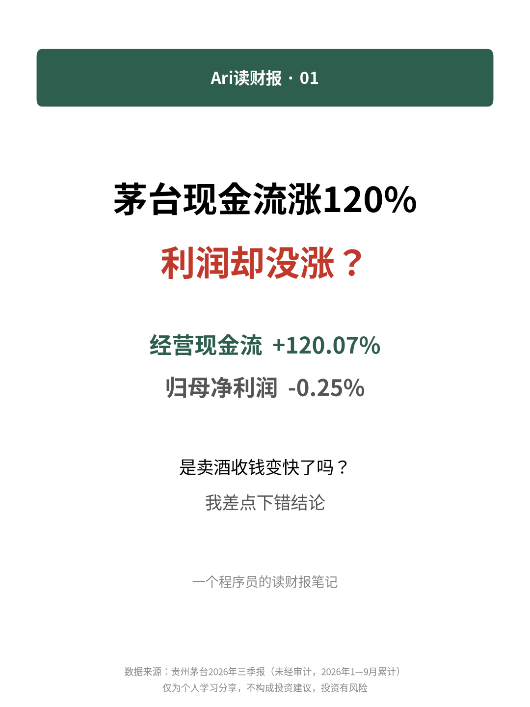
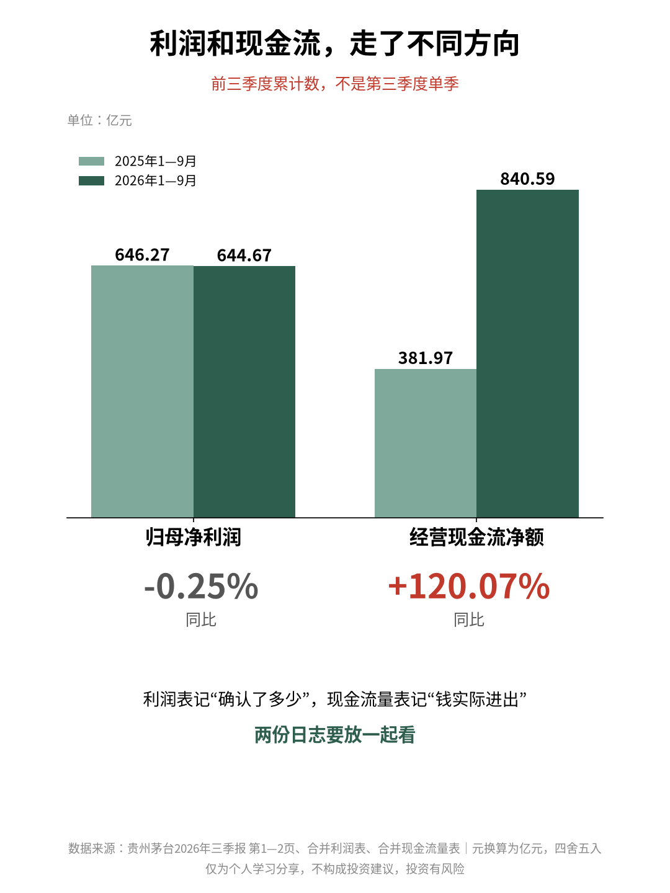
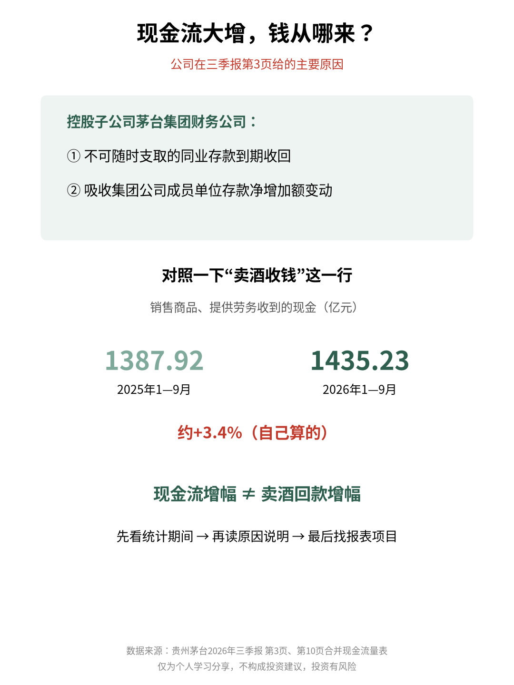

# 茅台现金流涨120%，利润却没涨？

| 项目 | 内容 |
|---|---|
| 作者 | Ari的财商笔记 |
| 首发日期 | 2026-10-31 14:50（北京时间） |
| 分类 | 读财报 |
| 发布平台 | 小红书 · [知乎](https://zhuanlan.zhihu.com/p/2099877518950113750) |

> 仅为个人学习分享，不构成投资建议，投资有风险。文中举例数字如标注“假设”，均为演示用，不对应任何真实产品或个人。

## 正文

利润没怎么动，经营现金流却大幅增加，这是卖酒收钱突然变快了吗？

翻开茅台最新三季报，我差点顺着这个念头写下结论。作为一个慢慢学价值投资的程序员，我过去总想给财报找个简单判断：利润不错，现金流也不错，应该就看懂了。

这次读下来，我发现，连“现金流不错”这句话，都得先把来龙去脉弄清楚。

贵州茅台《2026年第三季度报告》第1—2页列出：年初至报告期末，归属于上市公司股东的净利润约644.67亿元，同比下降0.25%；经营活动产生的现金流量净额约840.59亿元，同比增长120.07%。金额由原文人民币元换算为亿元，四舍五入保留两位小数。

注意，这里说的都是前三季度累计数，不能把它们当成第三季度单季的表现。报告里“本报告期”和“年初至报告期末”挨在一起，我给自己做了个标记：读数字之前，先看列名。

我这次想弄懂的，是利润和经营现金流为什么可以走出不同方向。

我的理解是，利润表关心一段时间里确认了多少收入、发生了多少成本费用；现金流量表则追踪现金的流入流出。确认收入和收到钱，可能发生在不同时间；有些影响利润的费用，也不对应当期现金支出。

所以，利润与现金流有差异，本身并不奇怪。它们像程序里从不同角度记录业务的日志，要放在一起看，不能拿其中一份替代另一份。

但茅台这次还有个更容易漏看的细节。

报告第3页“一、主要财务数据（三）主要会计数据、财务指标发生变动的情况、原因”解释，经营现金流的变化主要涉及控股财务子公司：不能随时支取的同业存款到期收回，以及吸收集团公司成员单位存款的净增加额发生变化。

读到这里，我才把刚才那个“卖酒收钱变快”的想法划掉。按公司的解释，这次变化有财务子公司业务的影响，不能直接把现金流增幅理解成卖酒回款的增幅。

这也提醒我，熟悉一家公司的产品，不等于熟悉它的合并报表。我们想到茅台，脑子里可能是一瓶酒；报表统计的，却还包括纳入合并范围的子公司。现金从哪里来，要顺着具体项目往下找。

还有个口径问题，我也记在旁边：归母净利润扣除了属于少数股东的利润，合并经营现金流没有按同样方式扣除。直接拿这两个数字相除，再给出“利润含金量”的评价，可能会漏掉这个差别。

这次读报，我给自己留了个小习惯：看到现金流明显变化，先确认统计期间，再读公司的原因说明，最后回到现金流量表找对应项目。原因还没拆清楚，就先把判断空着。

如果你只看到“经营现金流大幅增长”这句话，会先看利润有没有跟上，还是先找这笔现金究竟从哪里来？

数据来源：贵州茅台酒股份有限公司《2026年第三季度报告》（未经审计），报告期为2026年1—9月。数据见第1—2页“一（一）主要会计数据和财务指标”；变动原因见第3页“一（三）”；报表口径参见“四（二）财务报表”中的合并利润表、合并现金流量表。

巨潮资讯网原文：https://static.cninfo.com.cn/finalpage/2026-10-31/1225649896.PDF

\#Ari读财报 #贵州茅台 #现金流 #财报学习

仅为个人学习分享，不构成投资建议，投资有风险。

## 配图

## 数据来源 / 核实记录

### 来源

- 贵州茅台酒股份有限公司《2026年第三季度报告》（未经审计），报告期为2026年1—9月，巨潮资讯网原文：<https://static.cninfo.com.cn/finalpage/2026-10-31/1225649896.PDF>
  - 归母净利润约644.67亿元（同比−0.25%）、经营活动产生的现金流量净额约840.59亿元（同比+120.07%）：第1—2页「一（一）主要会计数据和财务指标」，年初至报告期末口径。
  - 经营现金流变动原因（控股财务子公司不能随时支取的同业存款到期收回、吸收集团公司成员单位存款净增加额变化）：第3页「一（三）主要会计数据、财务指标发生变动的情况、原因」。
  - 报表口径：「四（二）财务报表」中的合并利润表、合并现金流量表。
- 金额由原文人民币元换算为亿元，四舍五入保留两位小数（自己算的）。

---

*仅为个人学习分享，不构成投资建议，投资有风险。*
