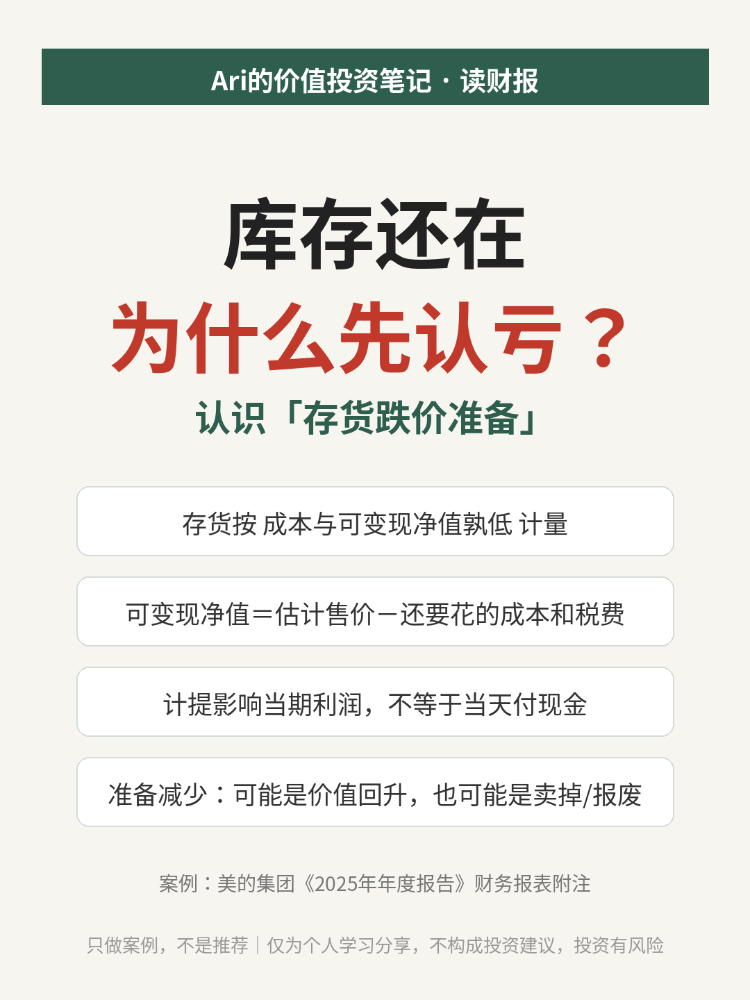
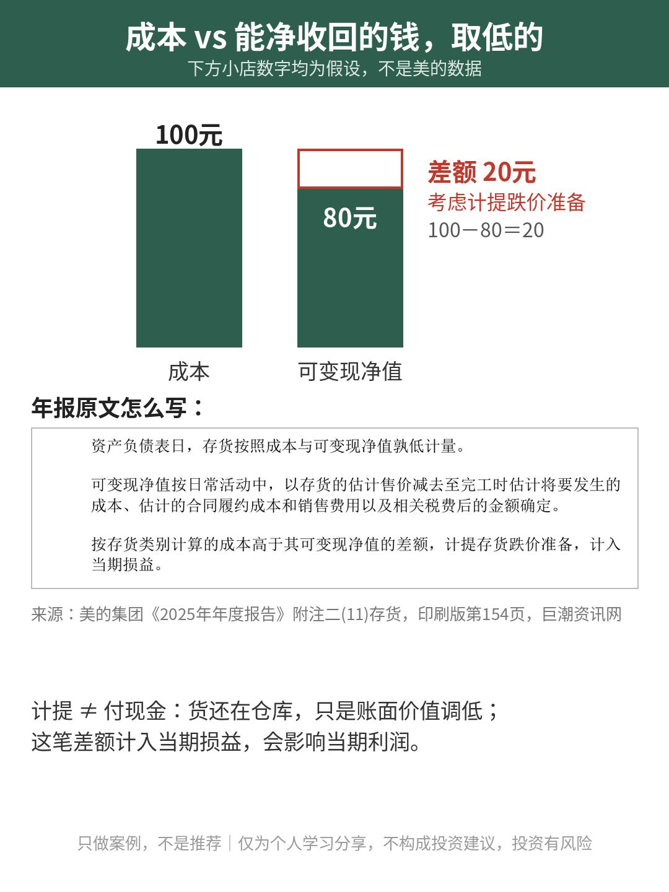
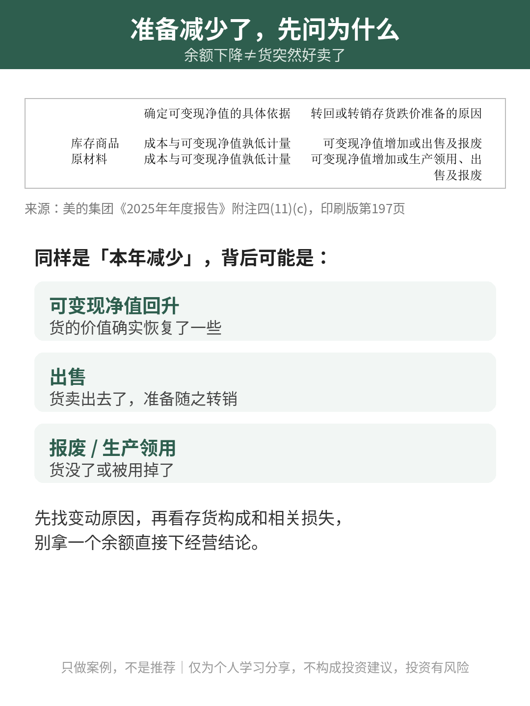

# 库存还在，为什么先认亏？

| 项目 | 内容 |
|---|---|
| 作者 | Ari的财商笔记 |
| 首发日期 | 2026-11-01 09:54（北京时间） |
| 分类 | 读财报 |
| 话题 | #价值投资 #财报学习 #存货跌价准备 #读财报 #财商 |
| 发布平台 | 小红书 · [雪球](https://xueqiu.com/9624362515/414942292) · 头条 |

> 仅为个人学习分享，不构成投资建议，投资有风险。文中举例数字如标注“假设”，均为演示用，不对应任何真实产品或个人。

## 正文

仓库里的货没丢，也还没卖，财报却先记了一笔损失，是不是账算错了？读家电公司年报时，这个问题值得停下来想想。

今天借美的集团2025年年报，认识一下“存货跌价准备”。只做案例，不是推荐。

① 买进来的成本，不一定都能收回来

货进仓库时按成本记账。但产品可能过季、技术可能更新，售价也可能变。如果一直按原成本记，资产就可能写得太乐观。

美的年报的会计政策写明：存货按“成本与可变现净值孰低”计量。通俗说，就是拿成本和预计能净收回的钱比一比，取低的那个。

这里的“净”很关键：不能只看标价，还要扣掉完工还要花的成本、合同履约成本、销售费用和相关税费。货没卖出去，也得重新评估它到底值多少。

② 计提准备，不是把钱转进另一个账户

假设一家小店有批货，成本100元，预计售价扣掉卖出去要花的钱后，只能净收回80元，差额20元就要考虑计提跌价准备。（以上金额都是假设，不是美的的数据）

计提是把这部分价值减少体现在账上，会影响当期利润；但计提这个动作本身，不代表当天又付出了一笔现金。货一般还在仓库，只是账面价值要调下来。

有点像写程序时校验输入数据：目的是让记录贴近现实，而不是存过一个数就再也不检查。

③ 看到准备减少，先问为什么

美的年报把存货跌价准备的变动单独列了出来，并说明库存商品的准备减少，可能来自可变现净值回升，也可能是货已经出售或报废。

所以看到准备余额下降，别直接理解成“货突然好卖了”。价格回升和货卖掉、报废掉，是不同的故事。先找变动原因，再看存货构成和相关损失，才不容易拿一个余额下经营结论。

你读存货时，先看仓库有多少货，还是先看这些货能不能按账面价值收回来？

资料来源：美的集团《2025年年度报告》财务报表附注“存货”部分（印刷版第154页、第197页），巨潮资讯网。

仅为个人学习分享，不构成投资建议，投资有风险

## 配图

## 数据来源 / 核实记录

### 来源

- 美的集团股份有限公司《2025年年度报告》（2026-03-31 披露），巨潮资讯网原文：<https://static.cninfo.com.cn/finalpage/2026-03-31/1225065145.PDF>
  - 存货按「成本与可变现净值孰低」计量、可变现净值的口径：财务报表附注会计政策「存货」部分（印刷版第154页）。
  - 存货跌价准备的变动及原因说明（可变现净值回升、出售或报废等）：财务报表附注「存货」项目（印刷版第197页）。
- 文中「成本100元、净收回80元、差额20元」为**假设**金额，不是美的的数据。

---

*仅为个人学习分享，不构成投资建议，投资有风险。*
