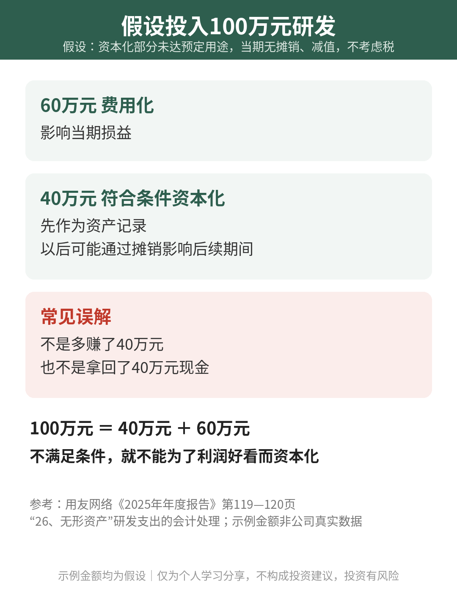

# 研发花的钱，为什么能变资产？

| 项目 | 内容 |
|---|---|
| 作者 | Ari的财商笔记 |
| 首发日期 | 2026-11-03（北京时间） |
| 分类 | 读财报 |
| 话题 | #价值投资 #财报分析 #研发投入 #财商 |
| 发布平台 | 小红书 · [雪球](https://xueqiu.com/9624362515/415218988) · 头条 |

> 仅为个人学习分享，不构成投资建议，投资有风险。文中举例数字如标注“假设”，均为演示用，不对应任何真实产品或个人。

## 正文

写代码、测试产品，花出去的研发钱，为什么有些进了费用，有些却出现在资产里？读科技公司的财报，这个岔路口值得停下来看看。

今天借用友网络年报认识“研发支出资本化”。只做案例，不是推荐。

① 写出了代码，不等于能记成资产

用友网络2025年年报把内部研发分为研究阶段和开发阶段。研究阶段的支出，发生时计入当期损益；开发阶段也不是自动通关，而要同时满足技术可行、能够产生经济利益、资源足够、支出能够可靠计量等条件。

可以这样理解：还在探索“能不能做”的投入，与已经具备条件推进成可用成果的投入，会计处理可能不同。项目起个好名字、做出一个演示版本，都不能代替这些条件。

② 资本化，改变的是入账路径

举个假设：一家软件公司投入100万元研发，其中40万元符合资本化条件，其余60万元费用化。假设资本化部分尚未达到预定用途，当期没有相关摊销或减值，也先不考虑税。

这时，60万元影响当期损益，40万元先作为资产记录。它不是多赚了40万元，也不是拿回了40万元现金。若以后形成使用寿命有限的无形资产，相关成本还会通过摊销等方式影响后续期间。

这组数只是说明入账路径，不是在说同一笔支出可以随意选择处理方法。不满足条件，就不能为了让当期利润好看而把费用留下来。

③ 读报表，顺着项目往后追

用友年报还披露了可行性研究、人员设备和资金支持，以及内部审议等资本化流程。读到这里，可以继续问：项目到了哪一步？资本化从何时开始？后面有没有形成可用成果？

所以，研发费用下降，不能单独证明研发投入减少；资本化增加，也不能单独证明研发更成功。把费用化支出、资本化支出和项目进展放在一起，才更接近完整画面。

你读科技公司财报时，会先看研发花了多少，还是先看这些钱做出了什么？

资料来源：用友网络《2025年年度报告》（巨潮资讯，第119—120页“26、无形资产”），研究/开发阶段区分、资本化条件和公司内部流程据此概括。文中100万元、40万元、60万元均为假设，不是用友网络真实数据。

仅为个人学习分享，不构成投资建议，投资有风险

## 配图

## 数据来源 / 核实记录

- 用友网络科技股份有限公司《2025年年度报告》，巨潮资讯原文 https://static.cninfo.com.cn/finalpage/2026-04-18/1225120765.PDF ，第119—120页（页脚119/261、120/261）“26、无形资产”。
- 核实：2026-11-03 下载原始 PDF（标题“用友网络科技股份有限公司2025年年度报告”，公司代码600588）。第119页：研究阶段支出于发生时计入当期损益；开发阶段支出同时满足技术可行、意图、经济利益、资源、可靠计量等条件才资本化。第120页：《可行性研究报告》、研发人员设备到位、资金预算支持、管理层审议表决形成《资本化项目决议》后开始资本化。与文中概括一致。
- 文中100万元＝40万元＋60万元均为假设，不是用友网络真实经营数据。

---

*仅为个人学习分享，不构成投资建议，投资有风险。*
