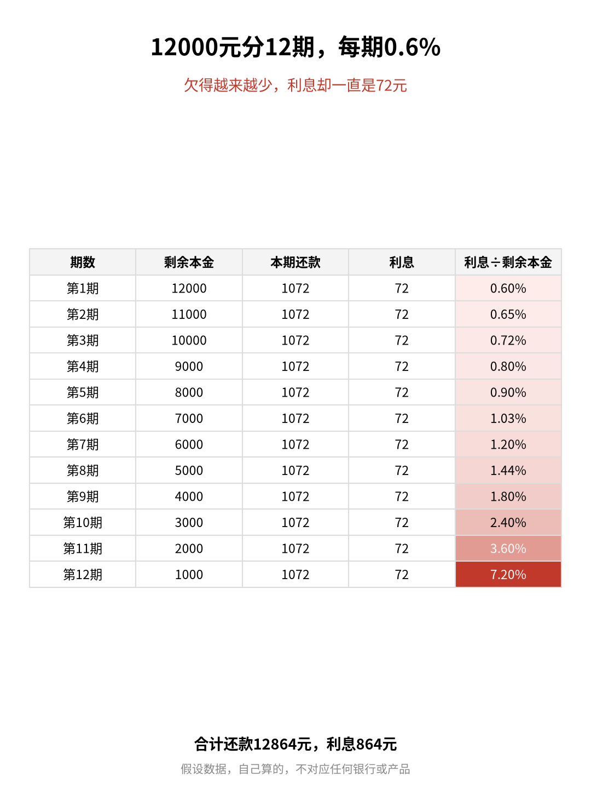
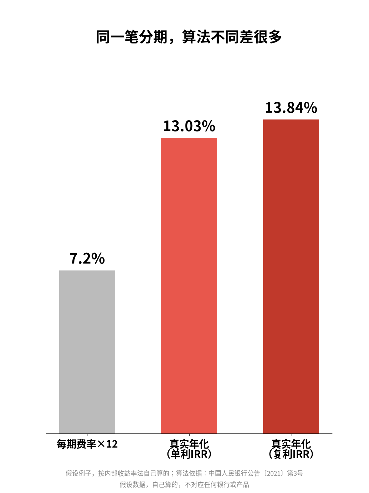

# 分期每期0.6%？真实年化约13%

| 项目 | 内容 |
|---|---|
| 作者 | Ari的财商笔记 |
| 首发日期 | 2026-10-30 17:55（北京时间） |
| 分类 | 财商 |
| 发布平台 | 小红书 · [雪球](https://xueqiu.com/9624362515/414840288) |

> 仅为个人学习分享，不构成投资建议，投资有风险。文中举例数字如标注“假设”，均为演示用，不对应任何真实产品或个人。

## 正文

📌 文中例子是我自己假设的数，不对应任何银行或产品。

买个12000元的东西，弹窗写着：分12期，每期只要0.6%💡

很多人心算：0.6%×12=7.2%，好像不贵？

先别急，按央行的口径算一遍👇

1️⃣ 钱是怎么还的

每期还本金1000元＋利息72元（12000×0.6%），共1072元，12期总利息864元。

关键在这：利息一直按12000元算，可你每还一期，欠的本金就少1000元。到最后一期只欠1000元，利息还是72元。

2️⃣ 真实年化怎么算

央行2021年第3号公告：贷款年化利率按“实际占用的本金”算，分期还本的，按每期还款后的剩余本金算；可以用复利（内部收益率IRR法）或单利，用单利要说明。

我用Python按IRR法算了一遍（自己算的）：

✅ 单利年化（月IRR×12）≈13.03%

✅ 复利年化≈13.84%

差不多是“7.2%”的1.8倍😮

（我先拿公告附件里的例子校验过算法，结果对得上。）

3️⃣ 规定已经要求直接写年化

🔹 2022年7月原银保监会和央行发的信用卡通知：分期合同首页和办理页面要明显展示年化利率和息费计算方式；资金成本要统一用“利息”形式展示，不能用手续费等形式。提前结清的，按实际占用的资金和期限计息。

🔹 2026年3月金融监管总局和央行发布《个人贷款业务明示综合融资成本规定》，8月1日起施行：办个人贷款要先看到“综合融资成本明示表”；线上消费分期要在支付页显著展示年化综合融资成本。

4️⃣ 我的3步自查

① 先找“年化利率”那一行，别只看每期费率

② 看清是单利还是复利，同一笔分期单利数字会小一点

③ 所有息费都算进去，再决定要不要分期

💭 我的感受：写代码时我习惯先看清公式再信结果。这次自己用Python算了一遍才发现，「每期0.6%」和真实年化差了快一倍，以后看到分期，我都会先找年化那一行。

你办分期时，看的是每期费率还是年化？评论区聊聊👇

仅为个人学习分享，不构成任何金融、投资或保险建议，具体以官方规定和合同为准。

## 配图

## 数据来源 / 核实记录

### 计算过程（假设例子，自己用 Python 复算）

- 假设：本金 P=12000 元；12 期按月还；每期还本 1000 元；每期利息 = 12000×0.6% = 72 元（按初始本金固定比例计息，是假设的计息方式，不代表任何银行的实际定价）；无其他费用；借款当期拿到全额 12000 元，第 1 个月末开始还款。
- 现金流（借款人视角）：第 0 期 +12000，第 1–12 期各 −1072。
- 求月度内部收益率 r，使 12000 = Σ(t=1..12) 1072 / (1+r)^t，二分法求解 → r ≈ 1.0862%/月。
- 单利年化 = r×12 ≈ 13.03%；复利年化 = (1+r)^12 − 1 ≈ 13.84%。
- 校验：同一段代码算央行公告附件示例三（本金10万元，当期付1000元服务费，12期每期8833.3元）得到单利12.80%、复利13.58%，与附件一致；示例二（100万元、240期、每月6599.6元）得到单利5.00%、复利5.12%，也与附件一致。
- 「1.8倍」= 13.03% ÷ 7.2% ≈ 1.81（自己算的）。

### 来源

1. 中国人民银行公告〔2021〕第3号（所有贷款产品均应明示贷款年化利率，含附件《采用内部收益率法计算贷款年化利率示例》），成文日期 2021-03-12，中国政府网 2021-03-31 发布：<https://www.gov.cn/zhengce/zhengceku/2021-03/31/content_5597156.htm>
   - 用到：第一条（明示年化利率）、第三条（按实际占用本金、分期按每期还款后剩余本金计算）、第四条（可用复利即IRR法或单利，单利要说明）；附件示例二、三（用于校验算法）。
2. 《中国银保监会 中国人民银行关于进一步促进信用卡业务规范健康发展的通知》（银保监规〔2022〕13号），2022-07-07，中国政府网：<https://www.gov.cn/zhengce/zhengceku/2022-07/07/content_5699827.htm>
   - 用到：第（二十一）条（分期合同首页和办理页面明显展示所有息费项目、年化利率和息费计算方式；资金使用成本统一采用利息形式）；第（二十二）条（提前结清按实际占用资金金额及期限计收利息）。
3. 《国家金融监督管理总局 中国人民银行公告（金规〔2026〕2号）个人贷款业务明示综合融资成本规定》，2026-03-03 发布，2026-08-01 起施行，中国政府网（国务院公报2026年第17号）：<https://www.gov.cn/gongbao/2026/issue_12806/202606/content_7072468.html>
   - 用到：第二条（综合融资成本明示表）、第三条第二款（线上消费分期在支付页面显著展示年化综合融资成本）、第十一条（施行日期）。
   - 配套解读：金融监管总局、人民银行有关司局负责人答记者问，人民银行网站 2026-03-15：<https://www.pbc.gov.cn/goutongjiaoliu/113456/113469/2026031320144944664/index.html>

---

*仅为个人学习分享，不构成投资建议，投资有风险。*
