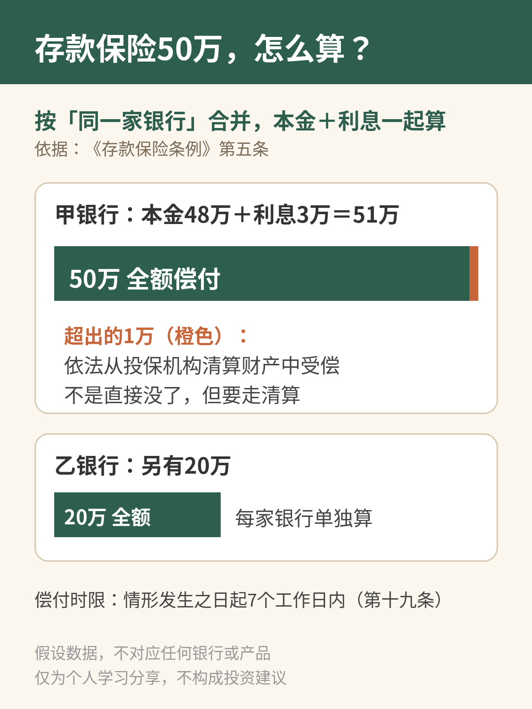
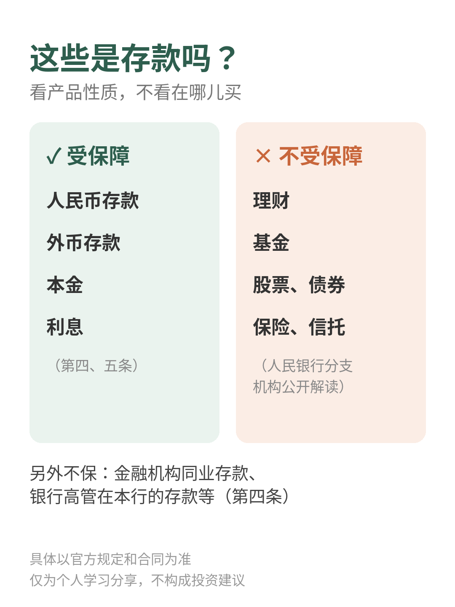

# 存款保险50万，到底怎么算？

| 项目 | 内容 |
|---|---|
| 作者 | Ari的财商笔记 |
| 首发日期 | 2026-10-30 22:31（北京时间） |
| 分类 | 财商 |
| 话题 | #存款保险 #财商 #理财知识 #存钱 #金融常识 #个人理财 |
| 发布平台 | 小红书 · [雪球](https://xueqiu.com/9624362515/414840614) |

> 仅为个人学习分享，不构成投资建议，投资有风险。文中举例数字如标注“假设”，均为演示用，不对应任何真实产品或个人。

## 正文

📌 文中例子是我自己假设的数，不对应任何银行或产品。

总听人说“存款保险保50万”，可50万到底怎么算？哪些钱才算存款？我把《存款保险条例》原文翻了一遍👇

1️⃣ 保的是什么

第四条：被保险存款包括投保机构吸收的人民币存款和外币存款。

不保的有：金融机构同业存款、银行高管在本行的存款等。

（投保机构＝商业银行、农村合作银行、农村信用合作社等吸收存款的银行业金融机构，见第二条）

2️⃣ 50万怎么算

第五条：最高偿付限额为人民币50万元。

关键是这句：同一存款人在同一家投保机构所有被保险存款账户的存款本金和利息合并计算，在限额以内全额偿付；超出部分依法从投保机构清算财产中受偿。

划重点👇

🔹 按“同一家银行”合并算，不是按单个账户算

🔹 本金和利息加在一起算

🔹 超过50万的部分不是直接没了，而是参与清算受偿

条例出台时人民银行负责人答记者问提到：50万能为99.63%的存款人提供全额保护。

3️⃣ 假设算一笔

小A在甲银行本金48万，利息3万，本息合计51万：50万全额偿付，剩下1万走清算受偿。

小A在乙银行另有20万：乙银行单独算，全额偿付。

4️⃣ 什么时候赔、多久赔

第十九条：存款保险基金管理机构担任接管组织、实施撤销清算，或法院裁定受理破产申请等情形下，存款人有权要求偿付；应在情形发生之日起7个工作日内足额偿付。

5️⃣ 最容易搞混的⚠️

人民银行分支机构的公开解读里说得很清楚：理财、基金、股票、债券、保险、信托等投资类产品不属于存款，不受存款保险保障。

在银行App或网点买的，也不一定是存款。拿不准就看产品性质和合同写的是不是“存款”。

💭 我的感受：程序员看规则习惯直接读原文。这份条例一共23条，和普通人最相关的就第四、五、十九条，几分钟能读完，比看二手解读踏实。

你分得清自己的钱哪些是存款、哪些不是吗？评论区聊聊👇

具体以官方规定和合同为准。仅为个人学习分享，不构成投资建议，投资有风险。

## 配图

## 数据来源 / 核实记录

### 来源（每个数字/条款都打开原文核对过）

| 内容 | 来源 | 位置 |
|---|---|---|
| 被保险存款＝人民币存款和外币存款；同业存款、高管在本机构存款、管理机构规定不予保险的其他存款除外 | 《存款保险条例》国务院令第660号，https://www.gov.cn/zhengce/content/2015-03/31/content_9562.htm | 第四条 |
| 投保机构＝商业银行、农村合作银行、农村信用合作社等吸收存款的银行业金融机构 | 同上 | 第二条 |
| 最高偿付限额人民币50万元；同一存款人在同一家投保机构所有被保险存款账户本金和利息合并计算，限额内全额偿付，超出部分依法从投保机构清算财产中受偿 | 同上 | 第五条 |
| 偿付情形（接管、撤销清算、法院裁定受理破产申请、国务院批准的其他情形）；7个工作日内足额偿付 | 同上 | 第十九条 |
| 条例共23条；2015-02-17签署，2015-05-01施行 | 同上 | 第二十三条、国务院令正文 |
| 50万限额能为99.63%的存款人提供全额保护 | 国务院法制办、中国人民银行负责人就《存款保险条例》答记者问（人民银行太原中心支行网站转载）https://taiyuan.pbc.gov.cn/taiyuan/134011/134017/2524101/index.html | “最高偿付限额”一问（gov.cn原链接 content_2840896.htm 现已404） |
| 理财、基金、股票、债券、保险、信托等投资类产品不属于存款，不受存款保险保障 | 淮南市人民政府《【文字解读】介绍存款保险相关政策》https://www.huainan.gov.cn/public/118319871/1260766352.html ；人民银行深圳市中心支行答上证报（国家外汇管理局深圳市分局网站）https://www.safe.gov.cn/shenzhen/2020/0512/698.html （“非保本保息的理财产品因为不属于存款，所以不在保障范围之内”） | 第二问 / 相应问答 |
| 甲银行48万＋3万＝51万、乙银行20万 | **假设数**，自己编的例子，不对应任何银行 | — |

### 备注
- 条例原文本身没有逐项列出“理财、基金不是存款”，这句来自人民银行分支机构/地方政府的公开解读，正文已写明出处性质。
- 未点名任何银行或产品。

---

*仅为个人学习分享，不构成投资建议，投资有风险。*
