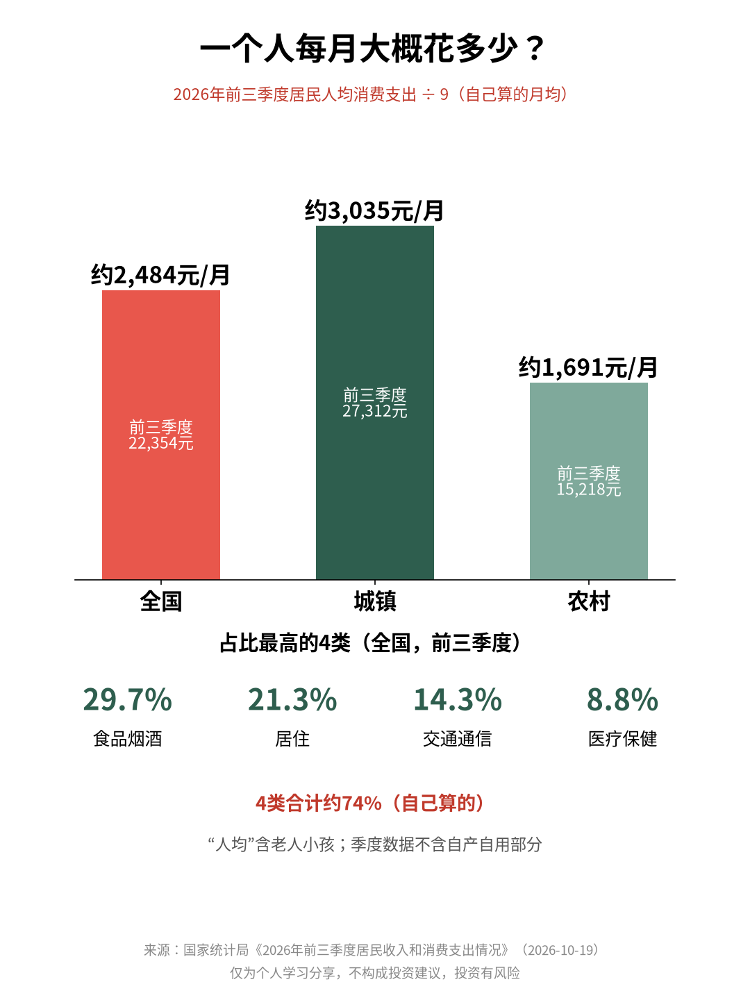
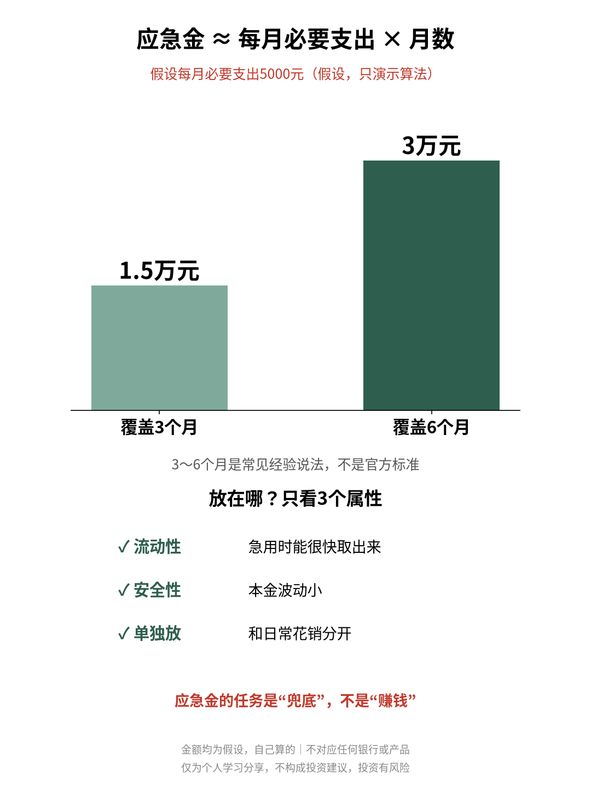

# 应急金留几个月才够？

| 项目 | 内容 |
|---|---|
| 作者 | Ari的财商笔记 |
| 首发日期 | 2026-10-31 09:31（北京时间） |
| 分类 | 财商 |
| 话题 | #应急金 #财商 #存钱 #理财知识 #个人理财 #金融常识 |
| 发布平台 | 小红书 · [雪球](https://xueqiu.com/9624362515/414871821) · [知乎](https://zhuanlan.zhihu.com/p/2099793454545090427) · 头条 · 公众号 |

> 仅为个人学习分享，不构成投资建议，投资有风险。文中举例数字如标注“假设”，均为演示用，不对应任何真实产品或个人。

## 正文

📌 文中个人支出金额都是我假设的，只演示算法，不对应任何产品。

以前我觉得“应急金”是个虚词，直到有次换工作空窗两个月，才发现手上能随时动用的钱比想象中少。今天把怎么估算捋一遍👇

1️⃣ 先看一个官方参照

国家统计局2026年10月19日发布：前三季度全国居民人均消费支出22354元。其中城镇居民27312元，农村居民15218元。

按9个月平均（自己算的）：全国每人每月约2484元，城镇约3035元，农村约1691元。

注意这是“人均”，家里的老人小孩也算一个人；而且季度数据不含自产自用部分。

2️⃣ 一个公式

应急金 ≈ 每月必要支出 × 想覆盖的月数

常见的经验说法是3～6个月，这不是官方标准，只是起点。

3️⃣ 什么算“必要支出”

统计局把消费分成八大类。前三季度占比最高的4类：食品烟酒29.7%、居住21.3%、交通通信14.3%、医疗保健8.8%，加起来约74%（自己算的）。

我自己的做法：房租房贷、吃饭、通勤话费、看病这些停不下来的算进去，旅游、换新手机先不算。

4️⃣ 假设算一笔

假设我一个人每月必要支出5000元：

🔹 覆盖3个月：1.5万元

🔹 覆盖6个月：3万元

收入越不稳定、要养的人越多，月数可以往上调。

5️⃣ 放在哪？只看属性

✅ 流动性：急用时能很快取出来

✅ 安全性：本金波动小

✅ 单独放：和日常花销分开，免得不知不觉花掉

应急金的任务是“兜底”，不是“赚钱”，收益高低排在最后。

💭 我的感受：写代码要给系统留降级方案，平时用不上，出事时才知道值不值。应急金就是生活里的降级方案。

你的应急金能撑几个月？评论区聊聊👇

仅为个人学习分享，不构成投资建议，投资有风险。

## 配图

## 数据来源 / 核实记录

### 来源

| 正文数字 | 来源（报告期 / 链接） |
|---|---|
| 前三季度全国居民人均消费支出22354元；城镇27312元；农村15218元；发布日期2026-10-19 | 国家统计局《2026年前三季度居民收入和消费支出情况》，报告期2026年1—9月，https://www.stats.gov.cn/sj/zxfb/202610/t20261019_1965612.html （2026-10-31 打开原文逐个数字核对） |
| 八大类占比：食品烟酒29.7%、居住21.3%、交通通信14.3%、医疗保健8.8% | 同上，“二、居民消费支出情况”段 |
| “季度收支数据中未包括居民自产自用部分的收入和消费” | 同上，“指标解释” |
| 月均：全国约2484元、城镇约3035元、农村约1691元 | 自己算：22354÷9=2483.8；27312÷9=3034.7；15218÷9=1690.9（前三季度=9个月；季度数据含季节因素，只作粗略参照） |
| 4类合计约74% | 自己算：(6643+4753+3190+1974)÷22354=16560÷22354=74.1%（也可用占比直接相加：29.7+21.3+14.3+8.8=74.1） |
| 每月必要支出5000元；3个月1.5万、6个月3万 | 假设金额，自己算 |
| 3～6个月 | 常见经验说法，正文已注明不是官方标准，不是来自官方数据 |

---

*仅为个人学习分享，不构成投资建议，投资有风险。*
