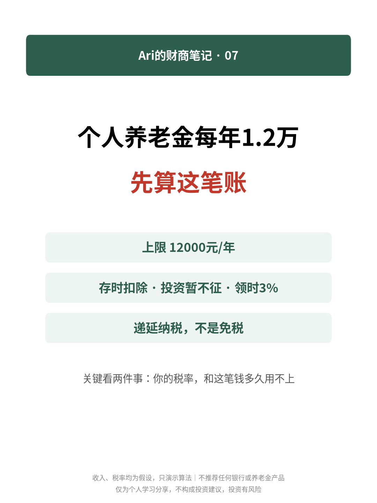
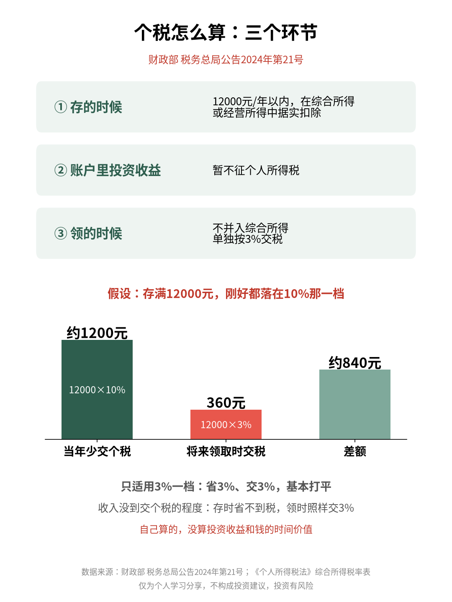
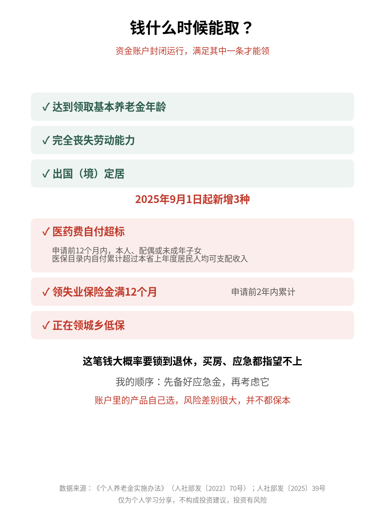

# 个人养老金每年1.2万，先算这笔账

| 项目 | 内容 |
|---|---|
| 作者 | Ari的财商笔记 |
| 首发日期 | 2026-11-02（北京时间） |
| 分类 | 财商 |
| 话题 | #个人养老金 #财商 #个税 #养老规划 #理财知识 |
| 发布平台 | 小红书 · [雪球](https://xueqiu.com/9624362515/415010134) · [知乎](https://zhuanlan.zhihu.com/p/2100518748084094145) · 头条 · 公众号 |

> 仅为个人学习分享，不构成投资建议，投资有风险。文中举例数字如标注“假设”，均为演示用，不对应任何真实产品或个人。

## 正文

📌 文中收入、税率都是我假设的，只演示算法，不推荐任何银行或养老金产品。

常有人问：个人养老金值不值得开？翻完几份官方文件，我发现关键不在开不开，而在两件事：你的税率，和这笔钱多久用不上👇

1️⃣ 谁能参加

2024年12月15日起全国实施：在中国境内参加城镇职工基本养老保险或城乡居民基本养老保险的劳动者，都可以参加。

2️⃣ 每年最多存多少

上限12000元/年，可以按月、分次或按年存，按自然年度累计。我查的时候（2026年10月），没查到调整上限的新文件。

3️⃣ 税怎么算：三个环节

🔹 存的时候：12000元/年以内，在综合所得或经营所得中据实扣除

🔹 账户里的投资收益：暂不征个税

🔹 领的时候：不并入综合所得，单独按3%交税

所以它叫“递延纳税”，不是免税。

4️⃣ 假设算一笔

假设我一年存满12000元，这笔钱刚好都落在10%那一档：

当年少交个税约1200元；将来领这12000元时交360元（3%）。

差额约840元（自己算的，没算投资收益和钱的时间价值）。

但如果只适用最低的3%一档，省3%、交3%，基本打平；收入还没到交个税的程度，存时省不到税，领时照样交3%。

5️⃣ 钱什么时候能取

资金账户封闭运行，满足其中一条才能领：

✅ 达到领取基本养老金年龄

✅ 完全丧失劳动能力

✅ 出国（境）定居

✅ 2025年9月1日起新增3种：申请前12个月内，本人、配偶或未成年子女医保目录内自付的医药费累计超过本省上年度居民人均可支配收入；申请前2年内领失业保险金累计满12个月；正在领城乡低保。

6️⃣ 我觉得最该想清楚的

这笔钱大概率要锁到退休，中途买房、应急都指望不上。我的顺序是先备好应急金，再考虑它。另外账户里买什么自己选，不同产品风险差别很大，并不都保本。

💭 我的感受：它像一个带锁的储蓄罐，锁是成本，税优是补偿。值不值，看自己的税率和现金流。

你开个人养老金账户了吗？评论区聊聊👇

仅为个人学习分享，不构成投资建议，投资有风险。

## 配图

## 数据来源 / 核实记录

### 核实记录，curl 打开原文并在

| # | 正文事实 | 来源（文件 / URL） | 原文摘录 |
|---|---|---|---|
| 1 | 2024-12-15起全国实施；参加条件 | 人社部 财政部 税务总局 金融监管总局 证监会《关于全面实施个人养老金制度的通知》（人社部发〔2024〕87号，成文2024-12-10），https://www.gov.cn/zhengce/zhengceku/202412/content_6992279.htm （另见国家税务总局法规库 https://fgk.chinatax.gov.cn/zcfgk/c100013/c5236500/content.html） | “自2024年12月15日起，在中国境内参加城镇职工基本养老保险或者城乡居民基本养老保险的劳动者，均可以参加个人养老金制度。” |
| 2 | 上限12000元/年 | 《个人养老金实施办法》（人社部发〔2022〕70号）第八条，https://www.gov.cn/zhengce/zhengceku/2022-11/05/content_5724783.htm | “参加人每年缴纳个人养老金额度上限为12000元，参加人每年缴费不得超过该缴费额度上限。人力资源社会保障部、财政部根据经济社会发展水平、多层次养老保险体系发展情况等因素适时调整缴费额度上限。” |
| 3 | 按月/分次/按年，自然年度累计 | 同上，第九条 | “参加人可以按月、分次或者按年度缴费，缴费额度按自然年度累计，次年重新计算。” |
| 4 | 三环节税收规则（扣除、投资收益暂不征、领取单独3%）；“递延纳税” | 财政部 税务总局公告2024年第21号（成文2024-12-12），https://www.gov.cn/zhengce/zhengceku/202412/content_6992498.htm ；国家税务总局法规库同文 https://fgk.chinatax.gov.cn/zcfgk/c102416/c5237110/content.html | “自2024年1月1日起，在全国范围实施个人养老金递延纳税优惠政策。在缴费环节，个人向个人养老金资金账户的缴费，按照12000元/年的限额标准，在综合所得或经营所得中据实扣除；在投资环节，对计入个人养老金资金账户的投资收益暂不征收个人所得税；在领取环节，个人领取的个人养老金不并入综合所得，单独按照3%的税率计算缴纳个人所得税，其缴纳的税款计入“工资、薪金所得”项目。” |
| 5 | 最低一档3%（综合所得） | 《中华人民共和国个人所得税法》第三条、第六条及税率表一，中国人大网 http://www.npc.gov.cn/npc/c2/c30834/201905/t20190521_281591.html （WebFetch 打开） | 第三条“综合所得，适用百分之三至百分之四十五的超额累进税率”；税率表一第1级“不超过36000元的”；第六条“以每一纳税年度的收入额减除费用六万元以及专项扣除、专项附加扣除和依法确定的其他扣除后的余额，为应纳税所得额”。另：gov.cn 解读稿称领取时“按国家规定的个人所得税最低一档税率缴税”（https://www.gov.cn/zhengce/202508/content_7037119.htm） |
| 6 | 例子：少交约1200元、领取交360元、差额约840元 | 自己算：12000×10%=1200；12000×3%=360；1200−360=840。10%为假设适用税率；10%档已核：国家税务总局法规库《个人所得税税率表（综合所得适用）》PDF（https://fgk.chinatax.gov.cn/zcfgk/c100012/c5221099/5221099/files/个人所得税税率表（综合所得适用）.pdf，2026-10-31 16:57 UTC+8 curl+pdftotext）：“2 超过 36000 元至 144000 元的 10 2520”；“1 不超过 36000 元的 3 0” | — |
| 7 | 资金账户封闭运行 | 《个人养老金实施办法》第十二条（同#2链接） | “个人养老金资金账户封闭运行，参加人达到以下任一条件的，可以按月、分次或者一次性领取个人养老金。” |
| 8 | 领取条件6种（含2025-09-01起新增3种） | 人社部等五部门《关于领取个人养老金有关问题的通知》（人社部发〔2025〕39号，成文2025-07-13），https://www.gov.cn/zhengce/zhengceku/202508/content_7037114.htm | “（一）达到领取基本养老金年龄；（二）完全丧失劳动能力；（三）出国（境）定居；（四）申请领取个人养老金之日前12个月内，本人或配偶、未成年子女发生的与基本医保相关的医药费用支出，扣除医保报销后个人负担（指医保目录范围内的自付部分）累计超过本省（自治区、直辖市）上一年度居民人均可支配收入的；（五）申请领取个人养老金之日前2年内，领取失业保险金累计达到12个月的；（六）正在领取城乡最低生活保障金的。”“本通知自2025年9月1日起实施。” |
| 9 | 产品风险各异（“并不都保本”的依据） | 人社部发〔2024〕87号 二（二） | “金融机构要按照规定做好个人养老金产品资产配置公示和风险等级确定工作……根据风险等级，分类展示个人养老金产品，强化风险提示。” |
| 10 | 2025–2026 是否有变化 | ① 12000上限：2026-10-31 检索未发现人社部/财政部调整上限的文件；辽宁省人社厅 2026-06-03 页面仍写“目前每年缴费上限为12000元/年”（https://rst.ln.gov.cn/rst/rdzcybw/2024091914435455596/index.shtml，仅见于搜索摘要）。② 税收：未发现替代2024年第21号公告的新公告。③ 领取条件：2025-09-01 起按人社部发〔2025〕39号扩充（已写入正文）。④《人力资源和社会保障事业发展“十五五”规划》（gov.cn 2026-07-09，https://www.gov.cn/lianbo/202607/content_7074801.htm）原文只写“完善个人养老金政策”；媒体称的“逐步提高缴费水平”未在该官方原文中看到，正文未采用。 | — |

---

*仅为个人学习分享，不构成投资建议，投资有风险。*
