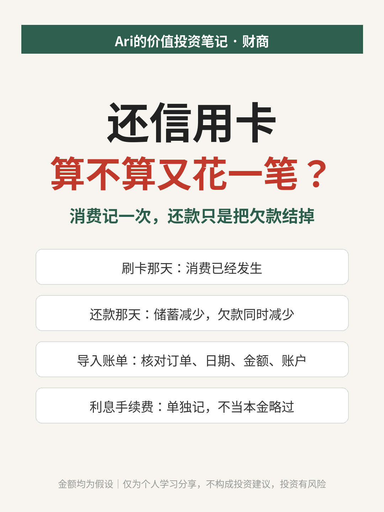
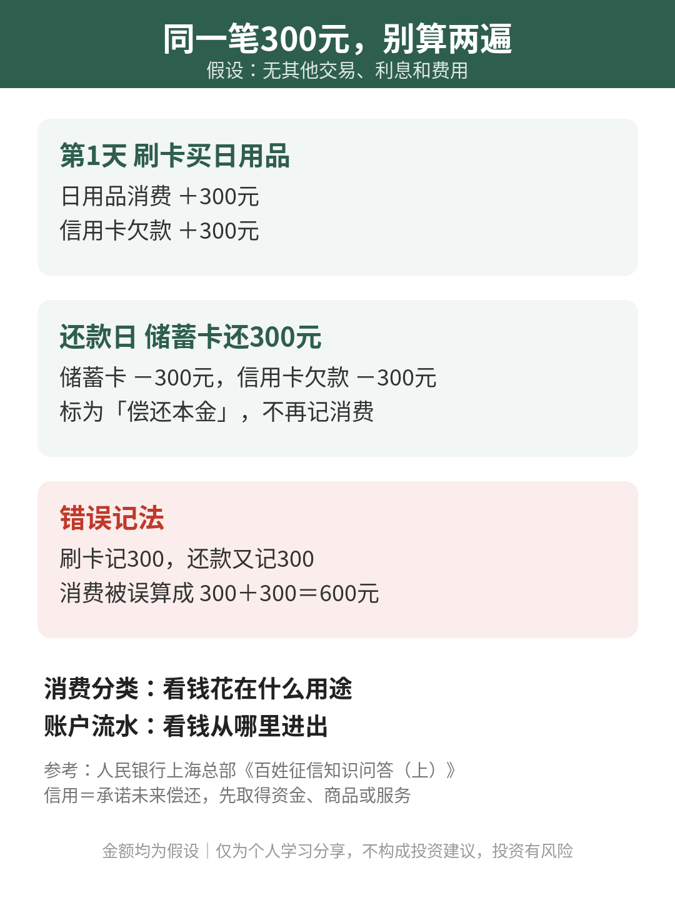

# 还信用卡，算不算又花一笔？

| 项目 | 内容 |
|---|---|
| 作者 | Ari的财商笔记 |
| 首发日期 | 2026-11-02（北京时间） |
| 分类 | 财商 |
| 话题 | #财商 #记账 #信用卡 #个人财务 |
| 发布平台 | 小红书 · [雪球](https://xueqiu.com/9624362515/415038675) · 头条 |

> 仅为个人学习分享，不构成投资建议，投资有风险。文中举例数字如标注“假设”，均为演示用，不对应任何真实产品或个人。

## 正文

明明只买了一件东西，记账软件却像多算了一笔支出？问题可能不在消费，而在你把“买东西”和“还欠款”加到了一起。

今天只聊一个小问题：如果想统计自己买了多少东西、用了多少服务，信用卡消费和还款该怎么分开记。

① 刷卡时，消费已经发生

举个假设：小林用信用卡买了300元的日用品，没有其他交易，也不产生利息或费用。

按消费发生时记录的口径，买东西当天，就在“日用品”下记300元，同时记下信用卡欠款增加300元。银行卡余额暂时没少，不代表这次消费没有发生。

这有点像程序里的同一个订单：付款方式不同，不该让订单消失。人民银行的征信知识材料，也把信用活动解释为在承诺未来偿还的前提下取得资金、商品或服务。

② 还款时，把欠款结掉

接着这个假设，小林从自己的储蓄卡转出300元，把这笔信用卡欠款还清。此时，储蓄卡里的钱减少300元，信用卡欠款也减少300元。

如果买东西时已经记了消费，这次还本金就别再放进“日用品支出”。否则，假设中实际购买300元的东西，会被消费统计误算成600元。

但还款记录也别删掉。它仍然是储蓄账户的资金流出，只是在这份消费分类账里，标为“偿还本金”，不重复累计为消费。若实际另有利息或手续费，需要单独记录，不能全部当本金略过。

③ 导入账单，先问记录的是什么

手动记过消费，又导入银行卡和支付平台账单时，可以核对订单、日期、金额及实际付款账户，再判断是不是同一笔。别看到金额相同就直接删除，碰巧买了两件同价商品也有可能。

给自己的账户转钱，同样需要与购物区分开。记录可以保留，但不要把每次转出都叫消费、每次转入都叫收入。

记账工具可以不同，口径尽量保持一致：消费分类看钱花在什么用途，账户流水看钱从哪里进出。这样回看时，才不容易把同一次购买算上两遍。

你记账时，最容易分不清的是信用卡还款，还是自己账户之间的转账？

资料来源：中国人民银行上海总部网站《百姓征信知识问答（上）》第5问“诚信、信用、征信是一回事吗？”（PDF第8页），仅引用“信用”的基础概念。文中300元、600元均为假设，不对应任何真实个人、银行产品或统计数据。

仅为个人学习分享，不构成投资建议，投资有风险

## 配图

## 数据来源 / 核实记录

- 中国人民银行上海总部网站《百姓征信知识问答（上）》第5问“诚信、信用、征信是一回事吗？”，PDF第8页：信用是指在交易一方承诺未来偿还的前提下，另一方向其提供资金、商品或服务的行为。原文：https://shanghai.pbc.gov.cn/eportal/fileDir/image_public/UserFiles/fzh_shanghai/upload/File/%E7%99%BE%E5%A7%93%E5%BE%81%E4%BF%A1%E7%9F%A5%E8%AF%86%E9%97%AE%E7%AD%94(%E4%B8%8A).pdf#page=8
- 核实：2026-11-02 下载原始 PDF，第7页起为第5问，第8页含上述“信用”定义，与文中引用一致；只引用基础概念，不引用该资料中的利率、期限或征信规则。
- 文中300元消费、300元还款、误计600元均为假设（无其他交易、利息和费用），300＋300＝600。

---

*仅为个人学习分享，不构成投资建议，投资有风险。*
